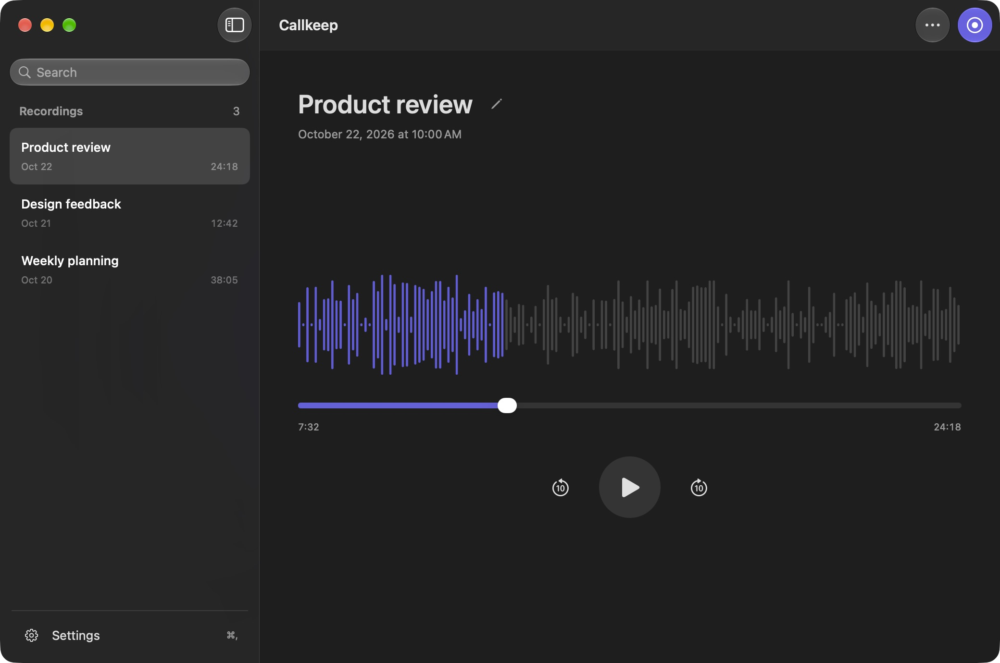
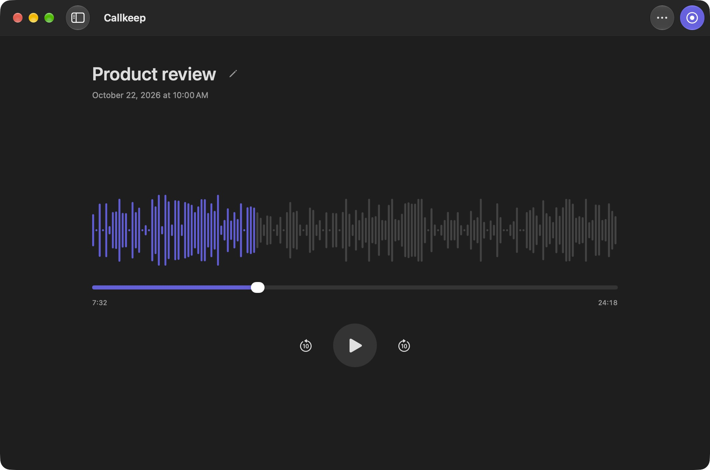
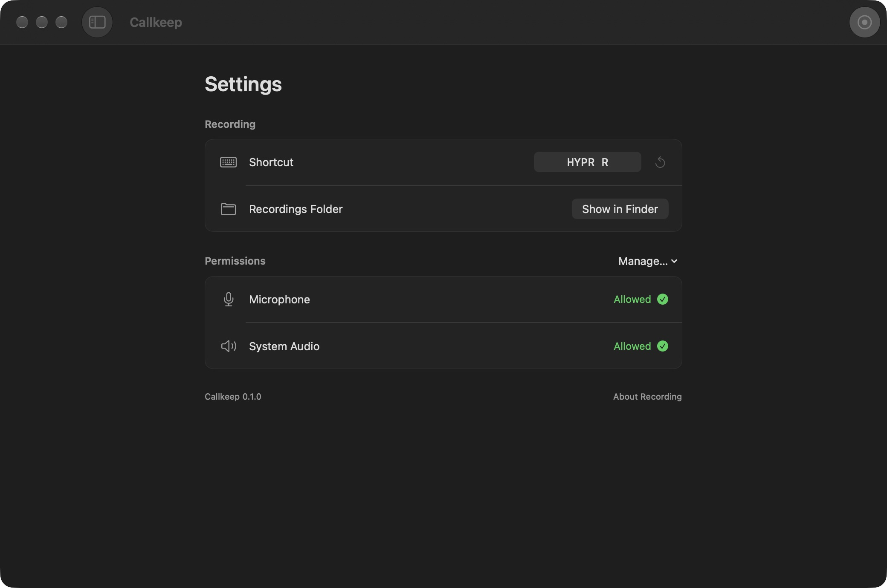

<p align="center">
  
</p>

<h1 align="center">Callkeep</h1>

<p align="center">A native macOS call recorder. Audio stays on your Mac.</p>
<p align="center"><strong>macOS 15+</strong> · SwiftUI + AppKit · Version 0.1</p>



## Record both sides of a call

Callkeep captures your microphone and the audio playing on your Mac. It works alongside your calling app without joining the meeting or adding a bot.

- Start or stop from the menu bar, the app, or a keyboard shortcut.
- Browse and search your recordings, then replay them with a smooth, seekable timeline.
- Rename a call in place. Select several with Shift-click or Command-click and move them to Trash together.
- Keep lossless audio locally, ready for transcription later.
- See permission status automatically, with guided setup when access is missing.

Transcription and live captions are not included in this version.

<table>
  <tr>
    <td width="50%"></td>
    <td width="50%"></td>
  </tr>
  <tr>
    <td align="center">Playback</td>
    <td align="center">Settings</td>
  </tr>
</table>

<sub>Screenshots show the app with generated sample recordings.</sub>

## Get started

1. Build and open Callkeep using the instructions below.
2. Open **Settings → Permissions** and enable microphone and system audio access. The app guides you to the relevant macOS controls.
3. Click **New recording**, then **Stop recording** when the call ends.

Get everyone’s agreement before recording. Callkeep captures audio from all apps, and muting your microphone in a calling app does not mute Callkeep. Headphones avoid recording speaker audio twice.

Closing the window keeps Callkeep running. Open it again from the Dock or menu bar.

## Keyboard shortcuts

| Action | Shortcut |
| --- | --- |
| Start / stop recording | **HYPR R** — ⌃⌥⇧⌘R, customizable in Settings |
| Show / hide sidebar | ⌘B |
| Open Settings | ⌘, |
| Rename selected recording | Return |
| Save / cancel rename | Return / Escape |
| Move selected recordings to Trash | ⌘⌫ |

## Build

Open `Callkeep.xcodeproj` in Xcode and run the **Callkeep** scheme, or use:

```sh
./Scripts/build.sh
open build/Build/Products/Release/Callkeep.app
```

The checked-in project has no external package dependencies. Local builds use ad-hoc signing by default. This prototype is not a notarized public release; its optional system-audio permission query uses a private macOS API.

[Development and permissions](docs/DEVELOPMENT.md) · [Recording and storage](docs/RECORDING.md) · [Validation](docs/VALIDATION.md)
