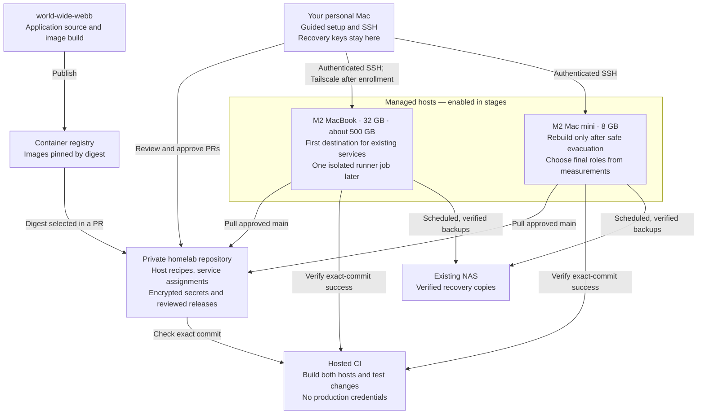

# homelab

Declarative macOS homelab for two Apple-silicon Macs. **Initial implementation:
deployment remains disabled.** The [readiness tracker](docs/implementation-status.md)
records unfinished work. No machine, network setting, service or account has
been migrated or removed by this repo work.

- **MacBook:** `homelab-macbook`, M2 / 32 GB / approximately 500 GB, reported macOS 27.2, existing
  Setup Assistant admin `admin`. First migration destination; one local CI job
  at a time after services and recovery are proven.
- **Mac mini:** `homelab-mac-mini`, M2 / 8 GB, existing admin `calum`. Keep it
  running until the MacBook works independently. Wiping/rebuilding it needs
  separate approval; final service placement remains flexible.

[Agreed plan](docs/plan.md) · [Current-state evidence](docs/current-state.md)

## System at a glance

This is the planned arrangement. **The new host configurations and update timers
are still disabled.** The existing mini remains the production system until
services are individually restored, checked and handed over.



Each enabled host pulls eligible configuration from Git; CI never connects to
the machines to deploy it. Colima and Compose run the retained applications,
with a separate bridged VM for Home Assistant. Runner VMs are a later, isolated
workload and receive no host credentials or service data.

Cloudflare DNS, routes and Access retain their existing management path in
`world-wide-webb`; homelab takes ownership of the tunnel process only at cutover.
UniFi remains outside the first rollout. See the
[ownership boundary](docs/plan.md#which-repository-owns-what).

## What each component does

| Component | Purpose |
| --- | --- |
| Nix flake + nix-darwin | Versioned host configuration, packages, accounts and boot services |
| nix-homebrew | Declared Homebrew packages; activation cleanup is `zap` |
| `_containers` | Non-admin owner of production container VMs and backups |
| Colima | General Docker VM, plus a separate bridged HA VM |
| `_runner` + disposable VMs | Planned isolated macOS/Linux ARM64 jobs; controller unfinished |
| SOPS + age | Encrypted Git secrets; each host receives only its own decryption key |
| Tailscale + OpenSSH | Tailnet access and key-only remote login |
| Backup job | Consistent snapshots, verified NAS copies and bounded local retention |
| Update job | Exact-main CI gate, backup, activation and health checks about every ten minutes |

The hidden service accounts use UID/GID 350 (`_containers`) and 351 (`_runner`).
The human account stays outside `users.knownUsers`. UID collisions and unexpected
admin membership block activation. Both humans currently expect UID 501; confirm
with `id -u` and change the reviewed host config if necessary.

## What merging to main will mean

Today, both hosts have services, runners and automatic updates disabled, and
`activationReady = false`. A merge does not install anything.

After bootstrap and separately reviewed enablement, each host fetches `main`,
requires successful push CI for that exact commit, builds it, takes a verified
backup and applies it under a shared operation lock. Failed application checks
hold for recovery; they do not blindly roll back a possibly migrated database.
See [update behavior](docs/updates.md) and [operation coordination](docs/operations.md).

`world-wide-webb` keeps the application and image build. Homelab tracks the
reviewed deployed digest. Promotion changes come through a PR here; the old
app repo deployer must be stopped before ownership transfers. See
[release ownership](docs/releases.md). No app extraction or second deployment
owner is required.

## Build and validate without deployment

Hosted ARM64 CI runs Rust and Python tests, parses all Compose models, and builds both
hosts plus an enabled service/HA/backup/update variant. It never activates them.
On an existing Apple-silicon Nix builder:

```sh
nix develop --no-update-lock-file --command python3 -m unittest discover -s tests
nix develop --no-update-lock-file --command bash -n bootstrap.sh
nix flake check --no-update-lock-file
nix build .#darwinConfigurations.homelab-macbook.system --no-update-lock-file
nix build .#darwinConfigurations.homelab-mac-mini.system --no-update-lock-file
```

`nix develop` supplies the pinned development and test tools, including Rust,
Cargo, rustfmt, Clippy, Python, Bash, Node and the Nix formatter. Node checks the
small in-container health probe; it is not an operator runtime dependency.
The operator menu, bootstrap, power/enrollment and health operations are compiled Rust;
remaining host utilities still use Python's standard library. Nix owns these
tool versions, so no separate mise, uv, pip installation or virtual environment
is required. The [client guide](client/README.md) covers local development.

Build success does not prove headless boot, network isolation, live credentials,
application correctness or restoration. Merging repository changes does not
authorize deployment; perform target testing only after deployment approval.

## First access to a fresh Mac

Do this once on the new MacBook; subsequent inspection and guided setup start
from your personal Mac. This step enables access, not deployment.

1. Finish Setup Assistant with the existing `admin` account, connect to the home
   network and plug in power.
2. Open **System Settings → General → Sharing → Remote Login**. Turn it on,
   choose **Only these users**, and add `admin`. Leave **Allow full disk access
   for remote users** off.
3. Note the hostname/address shown there and keep the Mac awake for the first
   connection. The CLI explains first-use trust on your personal Mac; you can
   choose that convenience or independently verify the fingerprint locally.

Enabling Remote Login does not install your SSH public key. Establishing initial
key authentication may require one more local step or an interactive password
prompt. Enter administrator passwords only in the authentication prompt, never
in chat or configuration files. Later bootstrap may also prompt for sudo.

No manual Nix, Homebrew or password-manager installation is needed for this
first-access step. Command Line Tools and the remaining bootstrap prerequisites
are handled in the separate readiness stage below. See the
[guided setup design](docs/management.md#setup-is-a-guided-workflow).

## Bootstrap a fresh Mac — after readiness review and approval

The [Rust client](client/README.md) provides a setup wizard: select a connection
profile and press **s**. It guides first-use SSH trust and public-key installation
when needed, then inspects the target. You can stop after verifying access,
without installing anything beyond the approved public key. To bootstrap,
continue to select the reviewed artifact and private input files,
review the evaluated host plan, and explicitly approve it. It handles transfer,
interactive administrator authentication, staging cleanup and reconnect through
the selected SSH route. Both current host definitions remain unready; the
wizard refuses their artifacts before transfer. No live setup has been run.

Homebrew distribution and subsequent management actions remain pending. The
numbered details below describe prerequisites and the manual target-side
mechanism for review, not commands to memorize for routine setup.

1. Finish the [readiness tracker](docs/implementation-status.md). Confirm the
   target Mac's OS, free storage, account/UID and network interfaces. The selected
   runner networking candidate requires macOS 26; Calum reports macOS 27.2
   on the MacBook, with exact-version compatibility still to test. Keep runners disabled during service migration.
2. Use Setup Assistant to create the intended human admin (`admin` on this
   MacBook). Install Apple's Command Line Tools and confirm `git` is available.
   Do not install a password manager or grant vault access on the target. Run
   bootstrap locally as that human account, never as root or on the still-live mini.
3. Generate a distinct host age identity on a trusted operator machine. Save its
   private key in 1Password on your personal Mac. Keep the separate operator
   recovery private key off every homelab host. Put only the public recipient and an operator
   recovery recipient in an exact host-path rule in `.sops.yaml`. Use SOPS to
   create `secrets/<host>.sops.yaml` with the [required catalog](docs/secrets.md).
   No real ciphertext or recipients are currently supplied in this repo.
4. Add verified human SSH public keys to `homelab.authorizedKeys`. Confirm the
   Tailscale auth key/tag policy and the private GitHub read token. Keep service
   assignments, backups, workers and updates disabled until each rollout stage
   is ready; enabling an empty service would not restore its data.
5. Review a host-specific PR setting `homelab.activationReady = true` only after
   prerequisites are met. Require CI success and record its exact 40-character
   commit. Download the private `homelab-bootstrap-COMMIT` artifact from that exact successful
   GitHub Actions run on your personal Mac. Extract its archive and verify
   `SHA256SUMS`; transfer the complete directory to the target. It contains a
   standalone helper built with pinned native Rust, a short launcher and the
   matching `REVISION`. The helper
   runs before Nix is installed; CI checks this on a separate fresh Mac.
6. On your personal Mac, export only this host's age private key and a
   repository-scoped GitHub read token into two mode-0600 files in a private
   temporary directory outside this repo. Never export your vault, recovery
   identity or password-manager session token. After approving bootstrap, use
   authenticated SSH/SCP to transfer those two files to a mode-0700 temporary
   directory owned by the target's administrator. Establish SSH access through
   the wizard's explicit first-use trust choice or an independent local host
   fingerprint comparison. If SSH is not yet available, follow the first-access
   checklist above.

   On the target, use the transferred file paths (not secret values):

   ```sh
   chmod 600 /PRIVATE_TEMP_DIRECTORY/host-age-key /PRIVATE_TEMP_DIRECTORY/github-read-token
   HOMELAB_BOOTSTRAP_APPROVED=homelab-macbook bash ./bootstrap.sh \
     homelab-macbook REVIEWED_40_CHARACTER_COMMIT \
     /PRIVATE_TEMP_DIRECTORY/host-age-key \
     /PRIVATE_TEMP_DIRECTORY/github-read-token
   ```

   Run this in the target's local terminal so sudo can prompt normally. Do not
   paste credentials into command arguments or shell history. After bootstrap
   has a confirmed terminal outcome, delete the two staging files on both
   machines; bootstrap removes its own private working copy but does not delete
   caller-owned inputs. If SSH disconnects or privileged work may still be
   running, preserve staging and inspect the private setup journal and processes
   before cleanup or retry. The guided wizard handles confirmed staging cleanup
   and reports uncertain outcomes explicitly.
   For a rebuilt mini use `homelab-mac-mini` and run as `calum`.
7. The Rust helper fetches the private repo at that exact commit, checks encrypted
   host-file presence, refuses an existing installed age key, installs Nix with
   the Determinate installer if needed, evaluates readiness/UID/SSH-key gates,
   builds the host, checks decryption, installs the key root-owned mode 0600,
   and runs `darwin-rebuild switch`. It uses the exact local checkout rather than
   giving root GitHub credentials for a `github:0x63616c/homelab/REV#HOST` fetch.
   **Nix may remain installed if a later preflight fails.** A private, nonsecret
   journal prevents concurrent setup and accidental replay. `--resume` permits
   retrying safe preflight/build phases for the same host and commit. An
   interruption during installation, key installation or activation stops for
   manual inspection; a working `nix` command alone cannot prove installation
   finished. The helper never overwrites an existing age key. Successful
   activation does not establish service health; perform the checks below.
8. Verify remote login, Tailscale, power behavior and a headless reboot while
   retaining local access. Then restore and migrate one service at a time using
   the [plan's cutover gates](docs/plan.md). Enable worker ownership and the
   update timer only after their recovery checks pass. Do not wipe the mini
   before independent operation and off-host restore are proven.

## Add another host

1. Record its actual hardware, OS, admin/UID, storage budget and network role.
2. Add `hosts/<host>.nix`, initially with activation, workloads and updates off;
   register it through `mkHost` in `flake.nix` and add a build check.
3. Extend the host allowlists in `client/src/bootstrap.rs`,
   `client/src/bootstrap_privileged.rs`, `client/src/remote_setup.rs` and
   `scripts/update.py`, plus the choices in `client/src/setup_wizard.rs`, NAS
   destination validation and backup verification. Add coverage for the new
   name. Runner assignment is separately restricted to the MacBook; do not
   grant a second slot by merely adding a host.
4. Create a new age identity and exact `.sops.yaml` rule, encrypted host file,
   reviewed SSH keys and appropriate Tailscale enrollment credentials. Never
   share a host private identity with another machine.
5. Select services explicitly and document the old/new deployment owner,
   consistent data transfer, address handoff, health checks and rollback path.
6. Review CI, bootstrap the reviewed commit after approval, and repeat headless
   and restore validation before enabling automated changes.

## Operations and recovery

- [Secrets and rotation](docs/secrets.md): recipient changes and actual credential
  rotation are different operations. Recovery copies remain in 1Password on your personal Mac; hosts receive only their own keys.
- [Backups and verification](docs/backups.md): verify a downloaded set before an
  isolated restore; a valid checksum alone is not a working application restore.
- [Home Assistant](docs/home-assistant.md): preserve the bridged container VM;
  HA OS is a future disabled stub.
- [Health checks](docs/health.md): current checks and remaining integration probes.
- [Runner implementation](docs/runner-implementation.md): one-job policy,
  isolation constraints and unfinished controller work.

Testing-only `vov` retirement is approved for the later migration, but this repo
contains no account deletion or live service removal. Check remaining dependencies
before that separate operational step.
