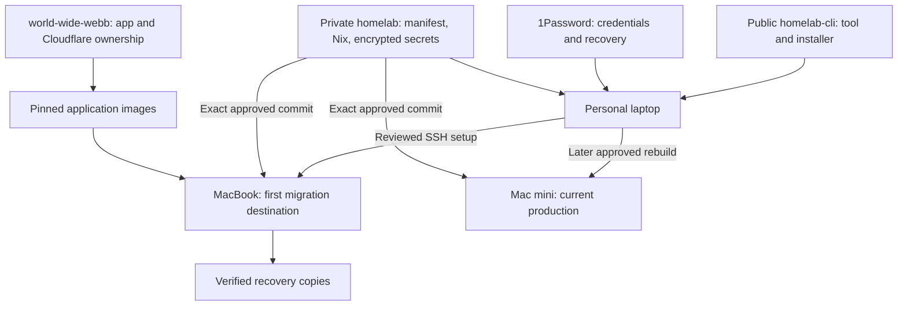

# homelab

Private configuration for the macOS homelab. **Deployment is still disabled.**
The existing Mac mini remains the production system; nothing is wiped or migrated
by merging this repository.

## Start here

Install the public [homelab CLI](https://github.com/0x63616c/homelab-cli), open
`homelab`, and attach **`0x63616c/homelab`** when asked.

1. On the target Mac, create its administrator and enable Remote Login.
2. In the CLI, select the Mac and follow **Connect → Prepare → Review & set up**.
3. Review encrypted configuration in Git before approving activation.

The CLI ships its bootstrap helper. Your personal laptop needs neither Nix nor a local
bootstrap build. Nix is installed and runs on the target only after approval.
See the short [setup guide](docs/setup.md).

## Architecture

| Component | Responsibility |
| --- | --- |
| Public CLI | Guided setup, SSH, credential adapters, portable bootstrap |
| This repository | Desired host state, services, encrypted secrets, private health/restore checks |
| `homelab.json` | Host facts shared by the CLI and Nix; no duplicate host lists |
| 1Password | Operator credentials and recovery keys; never installed on nodes |
| SOPS + age | Encrypted Git secrets; each node gets only its own key |
| launchd | Boot-time services and scheduled operations; no new management daemon |

## Hosts

| Host | Hardware | Administrator | Intended first role |
| --- | --- | --- | --- |
| `homelab-macbook` | M2, 32 GB, about 500 GB | `admin` | Safe migration destination; one runner later |
| `homelab-mac-mini` | M2, 8 GB | `calum` | Keep production running until verified cutover |

## What a merge does

Today, `activationReady` is false and updates/runners/services are disabled.
Merging changes Git only. Bootstrap, service migration and erasing a machine
require separate explicit approval.

Later, the enabled updater will require successful checks for the exact commit,
back up, apply and check health. Private-repository CI is currently constrained
by billing; public CLI checks do not substitute for private host checks.

## Find the details

- [Setup and adding a host](docs/setup.md)
- [CLI separation plan](docs/cli-extraction-plan.md)
- [Current-state research](docs/current-state.md)
- [Migration plan](docs/plan.md) · [Implementation status](docs/implementation-status.md)
- [Secrets](docs/secrets.md) · [Updates](docs/updates.md) · [Operations](docs/operations.md)
- [Application ownership](docs/releases.md) · [Recovery rehearsal](docs/restore-rehearsal.md)

`world-wide-webb` keeps application source and current Cloudflare management.
Only the tunnel process transfers at an explicitly reviewed service cutover.
