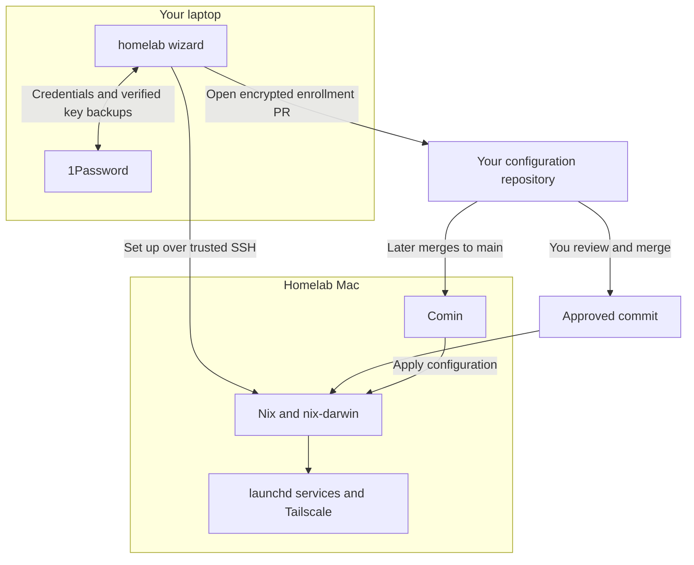

# homelab-cli

**Set up a Mac. Manage it from Git.**

A guided terminal installer for Apple silicon macOS homelabs. Connect to a new
Mac, approve its configuration, and let the wizard handle credentials,
installation and reboot checks. Afterwards, your configuration repository owns
changes—not another dashboard.

> **Enrollment redesign in progress:** this README describes the upcoming
> release. The published Homebrew version does not yet include the complete flow.
> Follow [PR #2](https://github.com/0x63616c/homelab-cli/pull/2) for validation and release progress.

## What it handles

- **Connect:** verify the Mac and use your existing SSH key, including keys in
  the 1Password SSH agent.
- **Prepare:** create encryption identities, back them up to 1Password and verify
  those backups. Create a scoped Tailscale enrollment key and encrypt it.
- **Propose:** give the Mac its own read-only Git deploy key and open a PR with
  its encrypted configuration.
- **Set up:** wait for your merge, install the approved configuration, reboot and
  verify services, Git access and Tailscale SSH.
- **Resume:** keep the approved attempt and recovery state if setup stops.

Nix runs on the target Mac. You do not need Nix on your personal laptop.

## How it works



The public CLI contains the installer and tests. **Your own repository contains
hosts, services, Nix configuration and encrypted secrets.** This enrollment flow
requires Comin for updates: merging to `main` authorizes the next deployment.
The CLI finishes after enrollment.

## Requirements

| Where | What you need |
| --- | --- |
| Your laptop | Apple silicon macOS; GitHub CLI signed in; 1Password with its `op` CLI and desktop integration; the standalone Tailscale app and CLI, connected to your tailnet |
| New Mac | Apple silicon macOS; an administrator account; Remote Login enabled for that account; Apple's Command Line Tools; power and network access |
| Configuration | A GitHub repository implementing the [configuration contract](docs/configuration.md), including a locked nix-darwin flake |
| Tailscale | A tag-scoped OAuth credential saved in 1Password, and tailnet policy allowing your administrator's Tailscale SSH connection |

**1Password and Tailscale are required.** There is no provider-selection step.
The target receives its own scoped credentials; it does not receive your
1Password login or GitHub account token.

## Get started

Install the published CLI:

```sh
brew install 0x63616c/tap/homelab
homelab
```

For the upcoming enrollment flow:

1. **Choose your Mac.** Enter its address and administrator account. The wizard
   checks SSH access and guides you through trusting the host and choosing a key.
2. **Attach your configuration.** Enter `owner/repository` once, select the host
   configuration if needed, and review setup.
3. **Merge the PR.** The wizard prepares credentials and opens an enrollment PR.
   Review and merge it in GitHub; setup continues automatically.
4. **Wait for verification.** The wizard installs, reboots and reconnects before
   handing over to Git-managed updates.

Use **↑ / ↓** to choose, **Enter** to continue and **Esc** to go back. To reopen a
saved attempt, use `homelab setup --host NAME`.

Administrator authentication may be needed during setup. FileVault can require
someone to unlock the target locally after reboot. See the [setup guide](docs/setup.md)
for prerequisites and recovery; do not delete saved keys or journals to bypass an error.

## Security and scope

- Recovery identities stay off the target. Backups are verified before setup proceeds.
- Secrets are encrypted before being proposed to Git. Each Mac gets read-only
  repository access and a single-use Tailscale enrollment key.
- Setup binds to the reviewed configuration and trusted host identity. An uncertain
  installation or activation stops for inspection rather than being repeated blindly.
- The wizard does not migrate applications, register runners or erase machines.
  Those changes belong in your infrastructure project.

This is an early project. Synthetic tests and disposable-VM rehearsals have
[different coverage and limits](docs/testing.md); they do not establish that your
production services or tailnet policy are correct.

## Documentation

- [Setup and recovery](docs/setup.md) — prerequisites, authentication and interrupted setup.
- [Configuration contract](docs/configuration.md) — connect your private Nix repository.
- [Example manifest](examples/homelab.json) — host facts and credential references, not a complete flake.
- [Testing](docs/testing.md) — automated checks and disposable macOS rehearsals.
- [Contributing](CONTRIBUTING.md) — build, test and propose changes.
