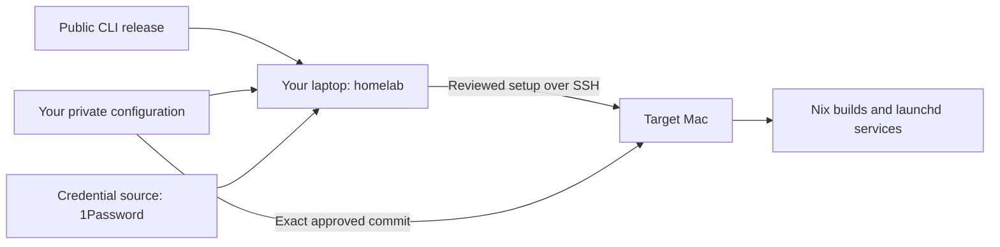

# homelab

A guided terminal client for declarative macOS homelabs.
Your configuration stays in your own repository. Nix runs on the target Mac,
not your personal laptop.

## Get started

```sh
brew install 0x63616c/tap/homelab
homelab
```

1. **Connect:** select a Mac and verify SSH access. On a fresh Mac, first create
   its administrator account and enable Remote Login.
2. **Prepare:** attach your configuration repository once (`owner/repository`),
   then prepare the missing credentials. The wizard remembers the repository and
   host binding. It uses the bootstrap helper shipped with this release.
3. **Review & set up:** review the exact configuration commit and target, then
   approve installation. The target installs Nix, checks the configuration and
   builds it before activation.

Use **↑ / ↓** to choose, **Enter** to continue and **Esc** to go back.
Opening the CLI never deploys. It never installs Nix on your client laptop.

## How it fits together



| Keep here | Keep in your configuration repo |
| --- | --- |
| UI, SSH, portable installer, credential adapters | Hosts, Nix, services, encrypted secrets |
| Synthetic tests | Private service checks and operational data |

Credentials and recovery keys are not compiled into the CLI. The 1Password
adapter runs only on your laptop; targets receive only their scoped secrets.

## Configuration and testing

- [Configuration contract](docs/configuration.md) — one small manifest, shared with Nix.
- [Setup and recovery](docs/setup.md) — what each step changes and how to resume.
- [Testing](docs/testing.md) — automated macOS journeys and their limits.

**Current scope:** SSH onboarding, local secret preparation and explicitly
approved bootstrap. Publishing encrypted configuration still requires repository
review. Runner registration, service migration and a persistent node agent are
not implemented by this wizard.
