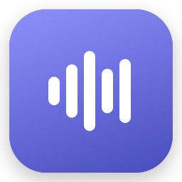
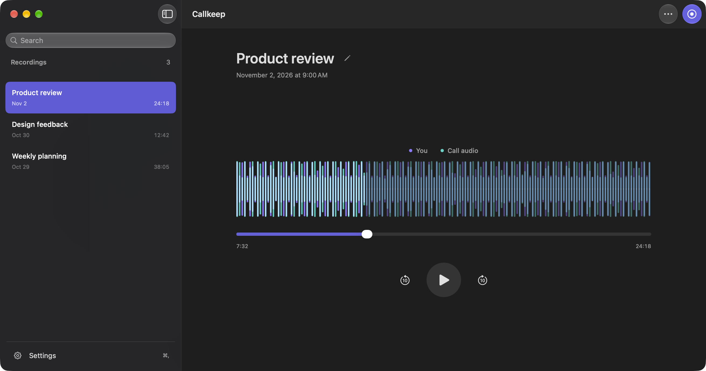
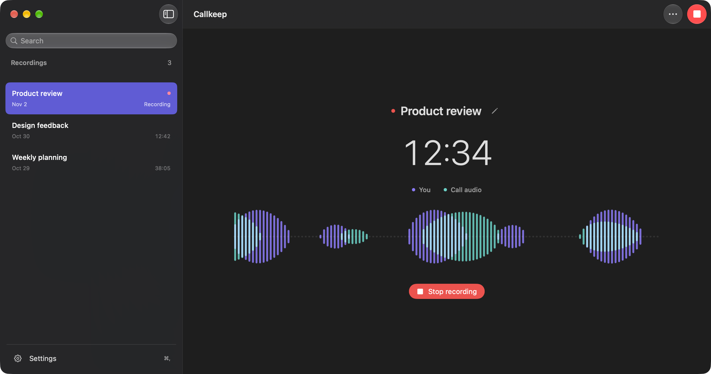
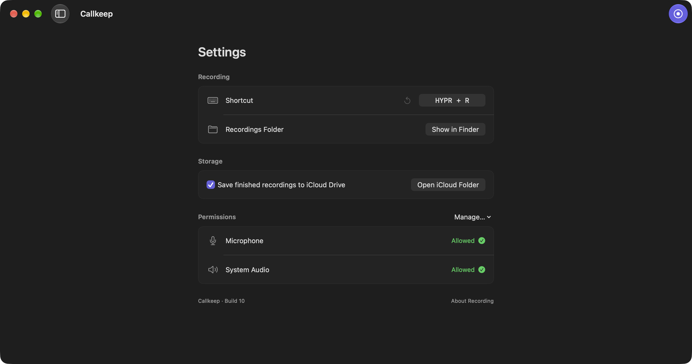

<p align="center">
  
</p>

<h1 align="center">Callkeep</h1>

<p align="center">A native macOS recorder for your microphone and computer audio, with optional iCloud Drive storage.</p>
<p align="center"><strong>macOS 15+</strong> · SwiftUI + AppKit · Apple silicon + Intel</p>



## Record both sides of a call

Callkeep captures your microphone and the audio playing on your Mac. It works alongside your calling app without joining the meeting or adding a bot.

- Start or stop from the menu bar, the app, or a keyboard shortcut.
- Browse and search your recordings, then replay them with a smooth, seekable timeline.
- Watch your voice and call audio together in a smooth, two-color waveform.
- Rename a call in place, including while recording. Select several with Shift-click or Command-click and move them to Trash together.
- Keep lossless audio in Callkeep’s native iCloud Drive folder, ready for transcription later.
- Import existing Callkeep recording folders without changing the originals.
- See permission status automatically, with guided setup when access is missing.

Transcription and live captions are not included in this version. See the [local transcription research and design](docs/TRANSCRIPTION.md).



<table>
  <tr>
    <td width="50%"></td>
    <td width="50%"></td>
  </tr>
  <tr>
    <td align="center">Playback</td>
    <td align="center">Settings</td>
  </tr>
</table>

<sub>Screenshots show the app with generated sample recordings.</sub>

## Get started

1. Install and open Callkeep using Homebrew or a release download below.
2. Open **Settings → Permissions** and enable microphone and system audio access. The app guides you to the relevant macOS controls.
3. Click **New recording**, then **Stop recording** when the call ends.

Get everyone’s agreement before recording. Callkeep captures audio from all apps, and muting your microphone in a calling app does not mute Callkeep. Headphones avoid recording speaker audio twice.

Closing the window keeps Callkeep running. Open it again from the Dock or menu bar.

## Keyboard shortcuts

| Action | Shortcut |
| --- | --- |
| Start / stop recording | **HYPR + R** — ⌃⌥⇧⌘R, customizable in Settings |
| Show / hide sidebar | ⌘B |
| Open Settings | ⌘, |
| Import Callkeep recording folders | ⇧⌘I |
| Rename selected recording | Return |
| Save / cancel rename | Return / Escape |
| Move selected recordings to Trash | ⌘⌫ |

## Install

```sh
brew install --cask 0x63616c/tap/callkeep
```

Or tap once, then install by name:

```sh
brew tap 0x63616c/tap
brew install --cask callkeep
```

Use **Callkeep → Check for Updates…** for in-app updates, or `brew upgrade --cask callkeep`. In-app updates wait for recording and file operations to finish. You can also download the app from
[GitHub Releases](https://github.com/0x63616c/callkeep/releases).
Requires macOS 15 or later on Apple silicon or Intel. New release builds are signed with Developer ID and notarized by Apple.
Versions through 0.1.3 were ad-hoc signed and may require approval in **System Settings → Privacy & Security**.

Finished recordings move to **iCloud Drive → Callkeep** by default when available.
Active recordings stay local. Change this in **Settings → Storage**.

## Build

Open `Callkeep.xcodeproj` in Xcode and run the **Callkeep** scheme, or use:

```sh
./Scripts/build.sh
open build/Build/Products/Release/Callkeep.app
```

Xcode resolves the pinned Sparkle update framework through Swift Package Manager. Local builds use ad-hoc signing by default. Native iCloud storage requires the provisioned, Developer ID signed release; ad-hoc builds keep new recordings local. The optional system-audio permission query uses a private macOS API.

[Development and permissions](docs/DEVELOPMENT.md) · [Recording and storage](docs/RECORDING.md) · [Validation](docs/VALIDATION.md)
