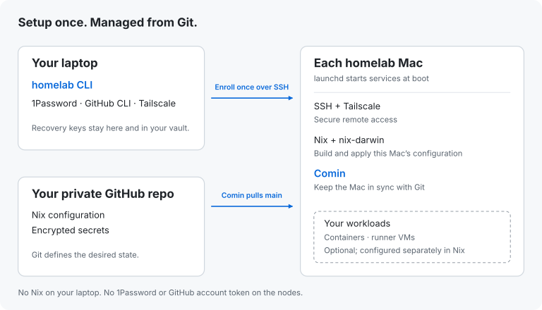

# homelab-cli

**Set up a Mac. Manage it from Git.**

A guided terminal installer for Apple silicon macOS homelabs. Connect to a new
Mac, approve its configuration, and let the wizard handle credentials,
installation and reboot checks. Afterwards, your configuration repository owns
ongoing changes.

## What it handles

- **Connect:** verify the Mac and use your existing SSH key, including keys in
  the 1Password SSH agent.
- **Prepare:** create encryption identities, back them up to 1Password and verify
  those backups. Create a scoped Tailscale enrollment key and encrypt it.
- **Publish:** give the Mac its own read-only Git deploy key and commit its
  encrypted enrollment configuration to `main`. Use a PR when review is required.
- **Set up:** install the approved configuration, reboot and
  verify services, Git access and Tailscale SSH.
- **Resume:** keep the approved attempt and recovery state if setup stops.

Nix runs on the target Mac. You do not need Nix on your personal laptop.

## How it works



The public CLI contains the installer and tests. **Your own repository contains
hosts, services, Nix configuration and encrypted secrets.** This enrollment flow
requires Comin for updates: merging to `main` authorizes the next deployment.
The CLI finishes after enrollment.

## Requirements

| Where | What you need |
| --- | --- |
| Your laptop | Apple silicon macOS; GitHub CLI signed in; 1Password with its `op` CLI and desktop integration; the standalone Tailscale app and CLI, connected to your tailnet |
| New Mac | Apple silicon macOS; an administrator account; Remote Login enabled for that account; power and network access |
| Configuration | A GitHub repository implementing the [configuration contract](docs/configuration.md), including a locked nix-darwin flake |
| Tailscale | A tag-scoped OAuth credential saved in 1Password, and tailnet policy allowing your administrator's Tailscale SSH connection |

**1Password and Tailscale are required.** There is no provider-selection step.
The target receives its own scoped credentials; it does not receive your
1Password login or GitHub account token.

## Get started

Install the published CLI:

```sh
brew install 0x63616c/tap/homelab
homelab
```

Setup starts with three choices, then runs as a live checklist:

1. **Open your repository.** Enter `owner/repository` once. Git supplies the host
   list, administrator accounts and desired configuration.
2. **Choose your Mac.** Enter its initial address once. Saved
   addresses and SSH identities are reused; missing developer tools install automatically.
3. **Begin setup.** Approve preparation, publication to Git, installation and
   reboot once. The checklist advances automatically and asks for attention only
   when needed, such as native authentication or a required PR review.

If repository rules require a PR, its link appears in the checklist; **O** opens
it in your browser. Setup continues automatically after merge. Existing saved
PRs keep their review path. Success means reboot and access checks passed and
Git-managed updates are enabled.

Use **↑ / ↓** to choose, **Enter** to continue and **Esc** to go back. To reopen a
saved attempt, select the same host again. Press **e** to edit a saved connection's
address without starting setup. `homelab setup --host NAME` also works.

Local files remember connection details and recovery progress, not a second host
configuration. Existing saved connections and keys survive this upgrade.

Administrator authentication may be needed during setup. FileVault can require
someone to unlock the target locally after reboot. See the [setup guide](docs/setup.md)
for prerequisites and recovery; do not delete saved keys or journals to bypass an error.

## Security and scope

- Recovery identities stay off the target. Backups are verified before setup proceeds.
- Secrets are encrypted before being committed to Git. Each Mac gets read-only
  repository access and a single-use Tailscale enrollment key.
- Setup binds to the reviewed configuration and trusted host identity. An uncertain
  installation or activation stops for inspection rather than being repeated blindly.
- The wizard does not migrate applications, register runners or erase machines.
  Those changes belong in your infrastructure project.

This is an early project. Synthetic tests and disposable-VM rehearsals have
[different coverage and limits](docs/testing.md); they do not establish that your
production services or tailnet policy are correct.

## Documentation

When editing your configuration, use the [editor schema](schema/homelab-v2.schema.json)
for autocomplete and run `homelab config validate ./homelab.json` to check it
offline. The schema describes the host fields and 1Password references; secrets
never belong in the manifest.

- [Setup and recovery](docs/setup.md) — prerequisites, authentication and interrupted setup.
- [Configuration contract](docs/configuration.md) — connect your private Nix repository.
- [Example manifest](examples/homelab.json) — host facts and credential references, not a complete flake.
- [Testing](docs/testing.md) — automated checks and disposable macOS rehearsals.
- [Contributing](CONTRIBUTING.md) — build, test and propose changes.

## License

[MIT](LICENSE).
