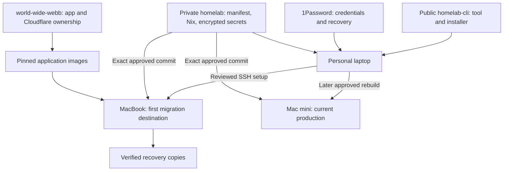

# homelab

Private configuration for the macOS homelab. **Deployment is still disabled.**
The existing Mac mini remains the production system; nothing is wiped or migrated
by merging this repository.

## Start here

Install the public [homelab CLI](https://github.com/0x63616c/homelab-cli), open
`homelab`, and attach **`0x63616c/homelab`** when asked.

1. On the target Mac, create its administrator and enable Remote Login.
2. Attach this repository in the CLI, select its Git-defined Mac and confirm the address.
3. Review **Begin setup**; follow the live checklist as the wizard prepares enrollment.
4. It publishes encrypted configuration to `main`, installs that exact commit,
   reboots and verifies the Mac. Required or existing PRs still wait for review.

This guide previews **CLI 0.4.0**, whose release and final validation are pending.
Released [0.3.2](https://github.com/0x63616c/homelab-cli/releases/tag/v0.3.2)
has Git-first selection and automatic prerequisites but uses PR-based enrollment.
In 0.4.0, Begin setup authorizes direct publication when GitHub rules permit it;
the CLI never force-pushes or bypasses required PR review.

`homelab.json` supplies the host list and administrator accounts. The CLI asks only
for a new host’s connection address, defaulting to `<host>.local`. Saved aliases,
SSH identities and setup state are reused; local connection settings are not a
second desired-host inventory. Resuming approved setup uses its saved exact Git
revision even if `main` changes or removes the host. Use **Edit address** to correct
a saved connection without recreating its setup.

The CLI ships its bootstrap helper. Your personal laptop needs neither Nix nor a local
bootstrap build. Nix is installed and runs on the target only after approval.
See the short [setup guide](docs/setup.md).

## Architecture

| Component | Responsibility |
| --- | --- |
| Public CLI | Guided setup, SSH, credential adapters, portable bootstrap |
| This repository | Desired host state, services, encrypted secrets, private health/restore checks |
| `homelab.json` | Host facts shared by the CLI and Nix; no duplicate host lists |
| 1Password | Operator credentials and recovery keys; never installed on nodes |
| SOPS + age | Encrypted Git secrets; each node gets only its own key |
| Comin | Pull and apply reviewed changes from `main` after enrollment |
| launchd | Start services at boot, including Comin |

## Hosts

| Host | Hardware | Administrator | Intended first role |
| --- | --- | --- | --- |
| `homelab-macbook` | M2, 32 GB, about 500 GB | `admin` | Safe migration destination; one runner later |
| `homelab-mac-mini` | M2, 8 GB | `calum` | Keep production running until verified cutover |

## What a merge does

After a Mac completes enrollment, Comin checks `main` every five minutes and applies
changes automatically. The interval is declared as `poller.period = 300` in
[`modules/updates.nix`](modules/updates.nix). Review and
test before merging; the node uses a read-only deploy key and needs no Actions token.
The wizard holds its approved commit through setup and reboot, then verifies the
handover to Comin. See [how updates work](docs/updates.md).

No real Mac has received this configuration. Host readiness remains false until
its enrollment PR is approved; application services and runners remain disabled.
Private Nix checks and the full disposable enrollment/reboot/Comin replay passed.
A later scheduled Git update and another reboot also passed. Release 0.3.0 passed
public CI and a fresh-Mac smoke test without Nix. See [VM evidence](docs/vm-validation.md) for
exact revisions and limits.
Private Actions workflows are manual-only until self-hosted runners are ready;
routine validation runs in the disposable Mac VM without paid private CI minutes.

## Find the details

- [Setup and adding a host](docs/setup.md)
- [CLI separation plan](docs/cli-extraction-plan.md)
- [Disposable VM validation](docs/vm-validation.md)
- [Current-state research](docs/current-state.md)
- [Migration plan](docs/plan.md) · [Implementation status](docs/implementation-status.md)
- [Secrets](docs/secrets.md) · [Updates](docs/updates.md) · [Operations](docs/operations.md)
- [Application ownership](docs/releases.md) · [Recovery rehearsal](docs/restore-rehearsal.md)

`world-wide-webb` keeps application source and current Cloudflare management.
Only the tunnel process transfers at an explicitly reviewed service cutover.
