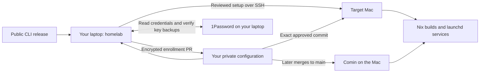

# homelab

A guided installer for declarative macOS homelabs.
Your configuration stays in your own repository. Nix runs on the target Mac,
not your personal laptop.

## Get started

```sh
brew install 0x63616c/tap/homelab
homelab
```

1. **Connect:** select a Mac and verify SSH access. On a fresh Mac, first create
   its administrator account and enable Remote Login.
2. **Approve setup:** attach your configuration repository once (`owner/repository`)
   and review the selected Mac. The wizard backs up keys to 1Password, prepares
   encrypted secrets and gives the Mac read-only repository access.
3. **Merge the enrollment PR:** review it in GitHub. The wizard waits for your
   merge, then installs that exact configuration, reboots the Mac and checks
   services, Git access and Tailscale connectivity.

After setup, the configuration repo's updater owns changes. With Comin, merging
to `main` is deployment approval: each Mac pulls and applies its configuration.
See [setup prerequisites and recovery](docs/setup.md) before starting; FileVault
can require a local unlock after reboot.

Use **↑ / ↓** to choose, **Enter** to continue and **Esc** to go back.
Opening the CLI never deploys. It never installs Nix on your client laptop.
To resume a saved Mac directly, run `homelab setup --host NAME` in a terminal.
The CLI handles enrollment; ongoing configuration changes belong in Git.

## How it fits together



| Keep here | Keep in your configuration repo |
| --- | --- |
| UI, SSH, portable installer, credential adapters | Hosts, Nix, services, encrypted secrets |
| Synthetic tests | Private service checks and operational data |

Credentials and recovery keys are not compiled into the CLI. The 1Password
adapter runs only on your laptop; targets receive only their scoped secrets.

## Configuration and testing

- [Configuration contract](docs/configuration.md) — one small manifest, shared with Nix.
- [Setup and recovery](docs/setup.md) — what each step changes and how to resume.
- [Testing](docs/testing.md) — automated macOS journeys and their limits.

**Scope:** enrollment, verified credential backups, an encrypted configuration PR,
bootstrap and post-reboot checks. Runner registration and service migration belong
in your configuration project. The CLI does not install a management agent;
your configuration supplies the updater and services.
