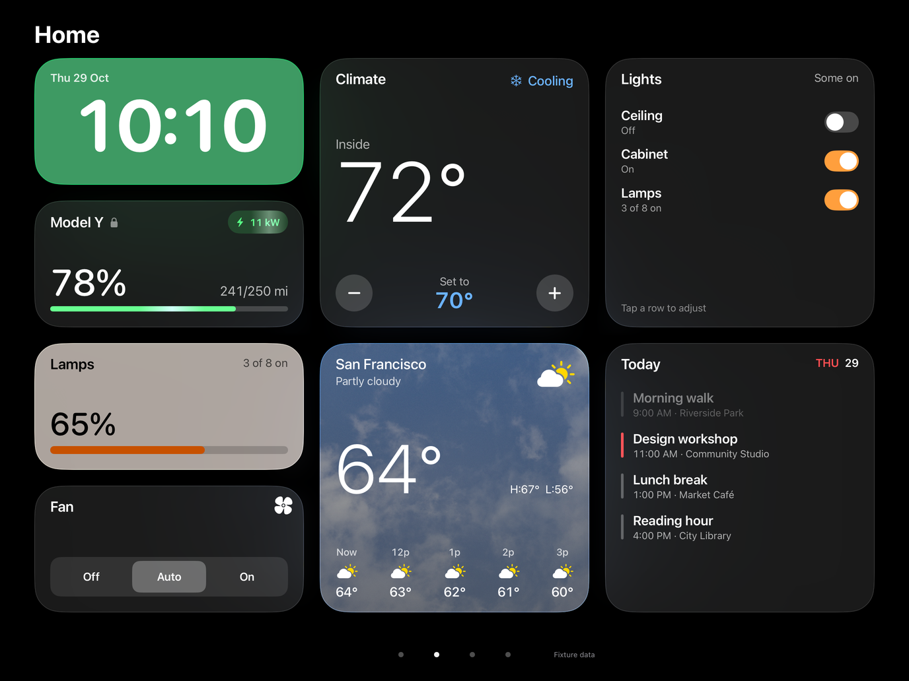
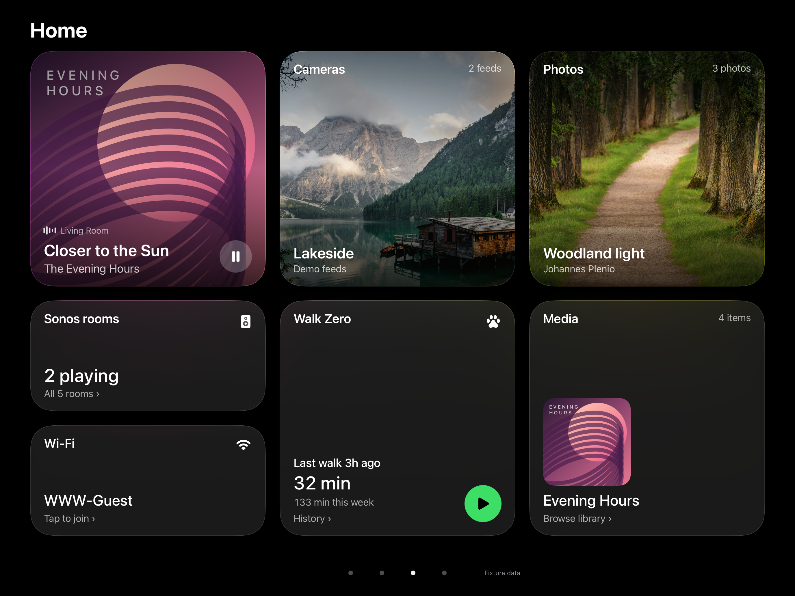

# Home grid (WWW-54, round 2)

iPad landscape Home (1376 × 1032 pt) is laid out on one fixed grid. Every card is built on it.

| Token | Value |
|---|---|
| Columns × rows | 6 × 4 |
| Unit cell | 192 × 192 pt (square) |
| Gutter | 24 pt, both directions |
| Grid size | 1272 × 840 pt, centred (52 pt side margins) |
| Vertical | 32 top · 40 heading · 16 gap · grid at y 88–928 · 80 pt pager band below |
| Card inset | 24 pt on all four sides, measured to ink (cap height at the top, baseline at the bottom) |
| Corner radius | 40 pt (1×1 round variants use a circle) |
| Allowed spans | 1×1, 2×1, 1×2, 2×2 |

A span of w×h is `w·192 + (w−1)·24` by `h·192 + (h−1)·24`, so 2×1 is 408 × 192 and 2×2 is 408 × 408.

## Even padding rule

Content is anchored to the four inset corners (`Corners` in `HomeGrid.swift`). The title sits top-left, the status goes top-right, the hero value sits bottom-left and the secondary value bottom-right. For example, Weather 2×1 puts "San Francisco" at the top-left inset and "64°" at the bottom-left inset. `Cap` trims SwiftUI's line-box padding so the 24 pt really is 24 pt to the glyphs on every side.

## Home pages (swipe; page dots)

Home is one continuous layout over pages of the same 6×4 grid. Page 1 fills all 24 cells; only the overflow goes to page 2, packed from the top-left with no holes. Both pages are titled "Home", with no date on the right (Clock H shows it). The grid is the shipped Home (WWW-54); page 2 replaces the old "Home · More" face (`-face controls` opens it). `-legacyHome` brings back the old module grid for comparison.

Page 1 (24/24 cells):

| Card | Variant | Span | Cell (col,row) |
|---|---|---|---|
| Clock (green) | H bold time + day in corner | 2×1 | 1,1 |
| Car | A charge first | 2×1 | 1,2 |
| Lamps | A count + bar | 2×1 | 1,3 |
| Fan | C Off/Auto/On | 2×1 | 1,4 |
| Climate | A hero | 2×2 | 3,1 |
| Weather | C now + next hours | 2×2 | 3,3 |
| Lights | D list (ceiling, cabinet, lamps) | 2×2 | 5,1 |
| Up next | B agenda | 2×2 | 5,3 |

Page 2 (24/24 cells):

| Card | Variant | Span | Cell (col,row) |
|---|---|---|---|
| Now Playing | B full-bleed | 2×2 | 1,1 |
| Cameras | A full-bleed feed + caption | 2×2 | 3,1 |
| Photos | A rotating photo + caption | 2×2 | 5,1 |
| Sonos rooms | A playing rooms + count | 2×1 | 1,3 |
| Wi-Fi | A guest network + join | 2×1 | 1,4 |
| Dog walk | A status + weekly total | 2×2 | 3,3 |
| Media | A library artwork + title | 2×2 | 5,3 |

All page-2 tiles are ordinary `GridPlacement`s. Cameras and Photos use full-bleed images with `Corners`/`Cap` captions at the 24 pt ink inset. Sonos rooms and Wi-Fi stack as wide cards beneath Now Playing; the Sonos title fits without truncation. Dog walk keeps inline start/end and opens the same history. Every card reads the existing `HomeDataSource` providers and opens the same detail as legacy Home.

Each new card also has a B variant: Cameras/Photos/Media/Dog walk offer a 2×1 glance; Sonos rooms offers a 2×2 room list and Wi-Fi a 2×2 join QR. Use `-gridSheet cameras|photos|sonosRooms|wifi|dogwalk|media` to inspect them.

In the Panel app, a card whose live source is not connected shows the module's "unavailable" tile in the same frame, and every card keeps the old `tile-<id>` accessibility identifier.

## Wide clock

Clock E–H are wide clocks: green tile, bold rounded numerals sized to fill the inset area, nothing else except an optional day. E 2×1 time only; F 2×2 time with the day underneath; G 2×2 hours stacked over minutes; H 2×1 time with the day in the top corner. `-gridSheet clockwide` renders just these four.

## Car charging

While the car is charging (the same condition that shows the kW badge), the green fill of the Car A battery bar shows a soft highlight sweeping left to right with a slight brightness pulse on a 1.8 s loop (`TimelineView(.animation)`, 60 fps). The kW badge gets the same sweep and pulse (`ChargingShimmer`); both read their phase from the clock, so they move in step. It is static when not charging or when Reduce Motion is on.

## Wallpaper

The wallpaper used to be hard-coded (`LakeWallpaper`). It is now a setting (`@AppStorage("wallpaper")`, `WallpaperChoice`):
- Black (`#000`, default; photos threw the layout review off);
- photos: Lake, Coast, Forest and Sky;
- Graphite (solid);
- Dusk (gradient).

To open the picker, long-press the "Home" title. For captures, use `-wallpaper <black|lake|coast|forest|cloud|graphite|dusk>`. `Wallpaper()` with no explicit asset follows the setting everywhere.

## Launch flags (prototype)

- `-legacyHome` uses the old module Home face instead of the grid.
- `-gridSheet <climate|lamps|weather|car|calendar|nowplaying|fan|lights|clock|clockwide|cameras|photos|sonosRooms|wifi|dogwalk|media>` renders a tile's variation sheet.
- `-face controls` opens on Home page 2.
- `-showWallpaperPicker` opens the picker at launch.
- `-gridOverlay` draws the grid in-app. Liquid Glass cards composite above it, so the review `grid.png` was made by drawing the same geometry over the Home capture.

## Car A range

The bottom-right of Car A shows `range/max mi` (e.g. 241/250 mi). Live max range is range ÷ battery %, rounded to the nearest 5 mi; below 10% battery the last good value is held, persisted in `UserDefaults` (`teslaMaxRangeMiles`). A lock glyph follows the car name while the car is locked (`-carUnlocked` for the unlocked capture).
