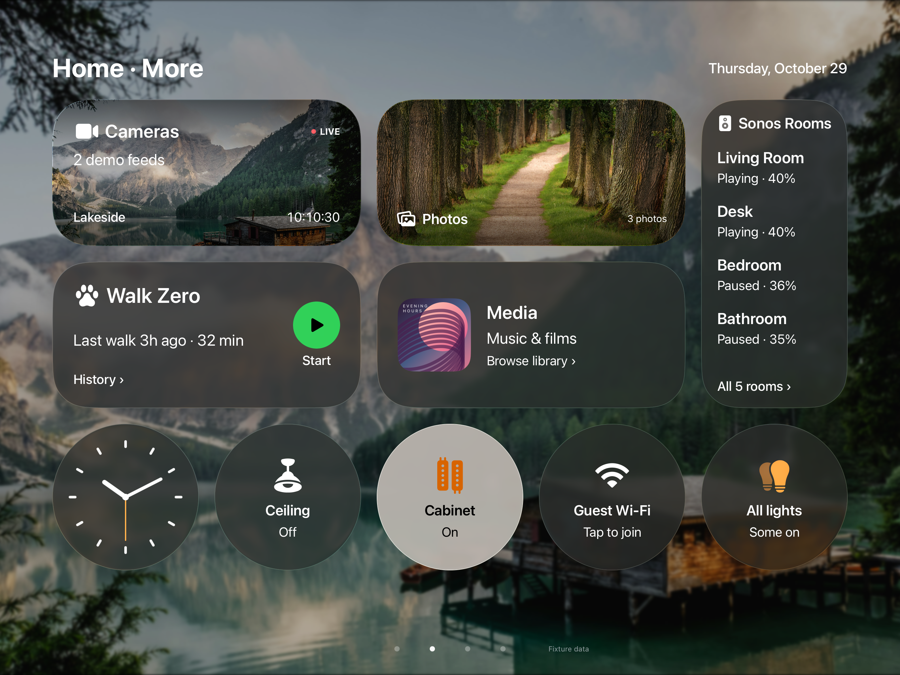
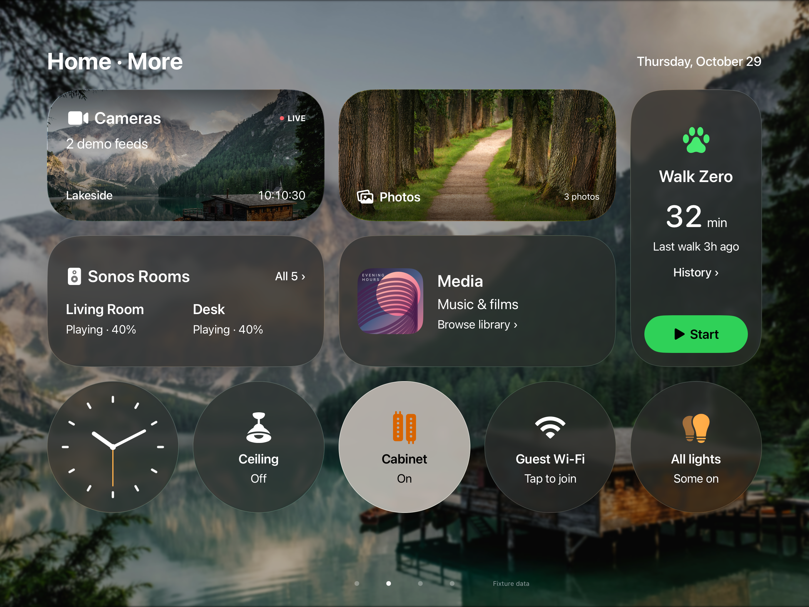

# WWW-55 — Controls and Walk tile review

The accepted source starts at `db92211f`. The historical Controls, idle Walk
and running Walk floors are 8.4 each. The target is 8.5 each, preserving every
other screen's accepted floor from external `baseline3/main-baseline-median.md`.

## Method

Use deterministic live-compositor captures with `-snapshot`, independent relaunch
pairs, shared simulator locking, readiness/PNG/orientation validation and an
RGB MAE limit of 0.5/255. The prototype canvas is 1376×1032 points; the separate
hybrid Panel schemes use a 1366×1024-point simulator. Clock/phase audit confirms
these fixture views use `store.now` and the injected motion phase.

`bash scripts/review-design.sh <review-input> <out-base> <protocol-dir> <baseline>`
uses the exact external `REVIEW-PROMPT-orch.txt` and `tools/median.py`, with three
independent cold reviews. WWW-55 explicitly requires `gpt-6.1-sol` at medium;
this is the only review setting changed from the external `review3.sh`'s Astra
xhigh invocation. The runner hashes the prompt, parser, spec and every image.
References stay external. Raw evidence is archived under
`/workspace/wwwebb-ui/prototype/v2/www55/`.

## Candidate 1 — rejected

`2c855bce` reduced wide-card heading differences, separated idle recency/duration,
and led with the running timer. All twelve relaunch pairs pass; maximum MAE
0.000612/255. Fresh baseline target pairs also pass (maximum 0.000601/255).

| File | Median | Runs | Gate | Δ vs base |
|---|---:|---|---|---:|
| main-clock-near.png | 9.0 | 8.8/9.0/9.0 | PASS ≥9.0 | -0.1 |
| main-controls.png | 8.3 | 8.1/8.4/8.3 | fail ≥8.5 | -0.1 |
| main-dogwalk-full-running.png | 8.5 | 8.5/8.6/8.5 | PASS ≥8.5 | -0.1 |
| main-dogwalk-full.png | 8.6 | 8.5/8.6/8.6 | PASS ≥8.5 | +0.1 |
| main-dogwalk-remote.png | 8.5 | 8.5/8.6/8.5 | PASS ≥8.5 | -0.1 |
| main-dogwalk-tile-running.png | 8.2 | 8.1/8.4/8.2 | fail ≥8.5 | -0.2 |
| main-dogwalk-tile.png | 8.3 | 8.1/8.4/8.3 | fail ≥8.5 | -0.1 |
| main-home.png | 8.3 | 8.3/8.4/8.2 | fail ≥9.0 | -0.2 |
| main-iphone-home-bottom.png | 8.4 | 8.4/8.6/8.4 | fail ≥8.5 | -0.1 |
| main-iphone-home.png | 8.3 | 8.3/8.6/8.3 | fail ≥9.0 | -0.3 |
| main-lamps.png | 8.4 | 8.4/8.7/8.3 | fail ≥9.0 | -0.6 |
| main-nowplaying.png | 8.7 | 8.7/8.8/8.7 | PASS ≥8.5 | -0.1 |

Runs parsed: [12, 12, 12] files each.

Controls 8.3, idle Walk 8.3 and running Walk 8.2 fall below their 8.4 floors.
Reject the entire visual candidate in `bc10831b`. Protected screens also receive
lower repeat scores; their visual source is unchanged and their archived-image
MAE is at most 0.000075/255. No historical floor is lowered and no protected-screen
improvement is claimed.

All five schemes build. Both prototype unit/render suites and the first three UI
tours pass. Stop the remaining candidate-1 verification after design rejection;
those partial results do not certify the final source. An initial verification
invocation used an invalid Panel simulator ID; retain it as failed setup evidence
and use the correct existing 1366×1024 simulator for subsequent runs.

## Candidate 2 — rejected; accepted source restored

`e6b20e69` gave idle duration and running elapsed equal numeric emphasis, aligned
Media's leading heading/bottom action with Walk and strengthened caption bands.
All twelve fresh relaunch pairs pass; maximum MAE 0.000026/255.

| File | Median | Runs | Gate | Δ vs base |
|---|---:|---|---|---:|
| main-clock-near.png | 8.8 | 8.7/8.8/8.8 | fail ≥9.0 | -0.3 |
| main-controls.png | 8.3 | 8.4/8.3/8.3 | fail ≥8.5 | -0.1 |
| main-dogwalk-full-running.png | 8.5 | 8.5/8.5/8.6 | PASS ≥8.5 | -0.1 |
| main-dogwalk-full.png | 8.6 | 8.5/8.6/8.6 | PASS ≥8.5 | +0.1 |
| main-dogwalk-remote.png | 8.5 | 8.5/8.5/8.6 | PASS ≥8.5 | -0.1 |
| main-dogwalk-tile-running.png | 8.3 | 8.4/8.3/8.2 | fail ≥8.5 | -0.1 |
| main-dogwalk-tile.png | 8.3 | 8.4/8.3/8.3 | fail ≥8.5 | -0.1 |
| main-home.png | 8.3 | 8.3/8.2/8.3 | fail ≥9.0 | -0.2 |
| main-iphone-home-bottom.png | 8.4 | 8.4/8.5/8.4 | fail ≥8.5 | -0.1 |
| main-iphone-home.png | 8.4 | 8.3/8.4/8.4 | fail ≥9.0 | -0.2 |
| main-lamps.png | 8.4 | 8.1/8.5/8.4 | fail ≥9.0 | -0.6 |
| main-nowplaying.png | 8.7 | 8.7/8.7/8.7 | PASS ≥8.5 | -0.1 |

Runs parsed: [12, 12, 12] files each.

All three target medians are **8.3**, below their **8.4** floors. Reject the
entire visual candidate in `bf695fd1`. Protected images differ from archived
accepted captures by at most 0.000075/255. No baseline is lowered.

The final Swift/UI source is identical to main after integrating WWW-64
(`c87324f1`). `HomeLaunch.swift` has no WWW-55 diff. Retained accepted medians are
**Controls 8.4 / idle Walk 8.4 / running Walk 8.4**; these are historical accepted
scores, not a new restored-state review. The 8.5 goal remains unmet.

The focused delivery retains the Sol-medium review runner, input hash manifests
and the experiment record. Before/after screenshots show the retained source and
the explicitly rejected second candidate; no candidate UI is shipped.

Final verification below runs against the restored source plus WWW-64; candidate-only
partial test results do not certify it.

## Fresh restored-state review

Twelve fresh restored relaunch pairs pass (maximum MAE 0.000564/255). Target
images match the fresh pre-change baseline within 0.000608/255. Run the same
three cold Sol-medium reviews on this restored set, without candidate spec text:

| File | Median | Runs | Gate | Δ vs base |
|---|---:|---|---|---:|
| main-clock-near.png | 8.8 | 8.8/8.8/8.7 | fail ≥9.0 | -0.3 |
| main-controls.png | 8.2 | 8.3/8.2/8.2 | fail ≥8.5 | -0.2 |
| main-dogwalk-full-running.png | 8.6 | 8.6/8.5/8.6 | PASS ≥8.5 | +0.0 |
| main-dogwalk-full.png | 8.6 | 8.6/8.5/8.6 | PASS ≥8.5 | +0.1 |
| main-dogwalk-remote.png | 8.6 | 8.6/8.5/8.6 | PASS ≥8.5 | +0.0 |
| main-dogwalk-tile-running.png | 8.3 | 8.3/8.2/8.3 | fail ≥8.5 | -0.1 |
| main-dogwalk-tile.png | 8.2 | 8.3/8.2/8.2 | fail ≥8.5 | -0.2 |
| main-home.png | 8.3 | 8.3/8.3/8.3 | fail ≥9.0 | -0.2 |
| main-iphone-home-bottom.png | 8.5 | 8.6/8.4/8.5 | PASS ≥8.5 | +0.0 |
| main-iphone-home.png | 8.3 | 8.5/8.3/8.3 | fail ≥9.0 | -0.3 |
| main-lamps.png | 8.4 | 8.5/8.4/8.4 | fail ≥9.0 | -0.6 |
| main-nowplaying.png | 8.7 | 8.8/8.7/8.7 | PASS ≥8.5 | -0.1 |

Runs parsed: [12, 12, 12] files each.

Fresh final target medians are **Controls 8.2 / idle Walk 8.2 / running Walk 8.3**.
These are repeat measurements of the unchanged accepted design, not accepted
replacement floors. Historical target floors remain **8.4/8.4/8.4**. The final
source has no visual change to accept; no floor is lowered and the goal remains
unmet. The screenshot comparison and source identity distinguish review
variation from a shipped regression.

## Final verification — PASS

`bash scripts/verify-schemes.sh final-verification`, using the isolated source
mirror/derived data and the correct per-product simulator destinations, passes:

- All five scheme builds (macOS, iPad, Snapshots, Panel and Panel-Smoke).
- Both prototype schemes: 149 unit tests and one hosted-render test each.
- All eight prototype UI tours, including live margins, paging/shared state,
  Lamps, Wi-Fi and remote Walk stop.
- The complete Panel unit scheme.
- Panel-Smoke: all 19 UI tests, zero failures, including WWW-64's return flow.

`swift test --jobs 2` in PanelKit passes all 70 tests across six suites. The
review runner completes all nine cold runs across two candidates and the restored
set; each median table contains twelve screens. Shell syntax, missing-baseline
preflight, diff checks and push lint/dead-code hooks pass.

Raw final build/test logs are archived off the mini at
`/workspace/wwwebb-ui/prototype/v2/www55/final-verification-logs.tar.gz`; the
associated `.xcresult` bundles remain in the task's Mac derived-data directories.
No visual design change is shipped. The fresh final target medians remain
**8.2/8.2/8.3**, against unchanged historical floors **8.4/8.4/8.4**.

## Follow-up 2 — tall Walk instrument rejected (2026-10-31)

Start: `eba45d82` on `WWW-55-controls-walk-2`. Candidate `87060098`
exchanges the wide Walk and tall Sonos spans: Walk becomes a tall instrument
with a 52-pt last-duration value or 44-pt running timer, an originating-device
label, History and a fixed 64-pt Start/End capsule. Sonos becomes a wide,
two-column summary of the first two rooms with a count linking to every room.
This is a structural layout trial rather than another shallow-card spacing pass.
Home Climate, the first Home page and compact phone composition are untouched.

Run the existing `scripts/review-design.sh` with its unchanged fixed prompt,
Sol medium and three independent cold reviews for **each** fresh baseline and
candidate set. Both sets contain all twelve required captures. Use `-snapshot`,
the existing shared simulator lock, readiness/orientation/PNG checks, and two
independent launches per screen. All 24 pairs pass: maximum RGB MAE is
**0.000571/255 baseline** and **0.000572/255 candidate**.

| Screen | Historical floor | Fresh baseline median | Tall candidate median |
|---|---:|---:|---:|
| main-controls | 8.4 | 8.3 | 8.2 |
| main-dogwalk-tile | 8.4 | 8.3 | 8.2 |
| main-dogwalk-tile-running | 8.4 | 8.2 | 8.1 |
| main-home | 8.5 | 8.3 | 8.2 |
| main-lamps | 9.0 | 8.5 | 8.3 |
| main-clock-near | 9.1 | 8.8 | 8.7 |
| main-nowplaying | 8.8 | 8.7 | 8.6 |
| main-dogwalk-full | 8.5 | 8.5 | 8.5 |
| main-dogwalk-full-running | 8.6 | 8.5 | 8.5 |
| main-dogwalk-remote | 8.6 | 8.5 | 8.5 |
| main-iphone-home | 8.6 | 8.4 | 8.4 |
| main-iphone-home-bottom | 8.5 | 8.5 | 8.5 |

Reject: all three targets score **0.1 below the fresh baseline**, and
**0.2/0.2/0.3 below the historical floors**. Reviewers identify too many equally
weighted stops in the tall Walk stack, the two-line “Started on / iPad” origin,
and inconsistent destination headings across Controls. The wide Sonos summary
also needs an explicit “All 5 rooms” destination label. Do not apply unrelated
review suggestions to Home Climate.

All nine protected images match the fresh baseline within **0.000065/255**;
Home is pixel-identical. Lower repeat scores on these protected screens do not
establish a source regression or justify replacing their accepted floors. The
candidate fails even on a same-session baseline comparison of its three targets.

Verification: fresh baseline and candidate iPad builds pass; candidate Snapshots
build-for-testing and **149 prototype unit tests** pass, including shared Walk
state and layout geometry. Repository `bun run typecheck`, normal push hooks
(Biome/Knip) and candidate branch CI pass. The first push failed because this
new worktree had no node_modules; `bun install --frozen-lockfile` restores the
locked dependencies and the normal retry passes. No hook is bypassed. Full
five-scheme/UI-tour verification is not repeated after design rejection; these
focused checks do not claim complete native release certification.

Revert candidate in `d81f65d2`. Final implementation is byte-identical to
`eba45d82`; the net branch diff contains documentation and evidence only.
Historical target floors remain **8.4/8.4/8.4**, and the **8.5 goal is unmet**.
No PR is opened, no merge/deploy is performed and no TestFlight build is uploaded,
following the ticket's explicit stop rule for a candidate that beats no baseline.

[Cold reviews, medians, input hashes and determinism tables](www-55-walk2/)
are checked in. Full raw capture pairs and build/test logs remain under
`/workspace/wwwebb-ui/prototype/v2/www55/walk2/`. Reference images stay external.
The screenshots below are actual compositor captures at 2752×2064 pixels
(1376×1032 points), and the candidate screenshots show a **rejected experiment**.

