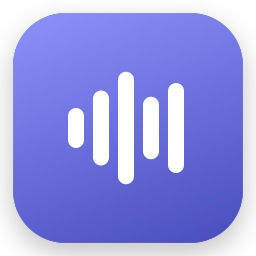
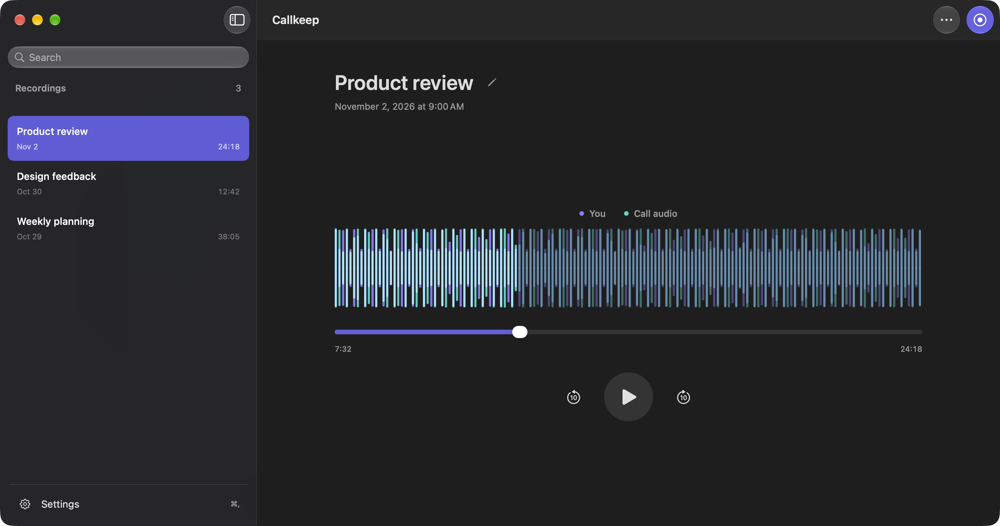
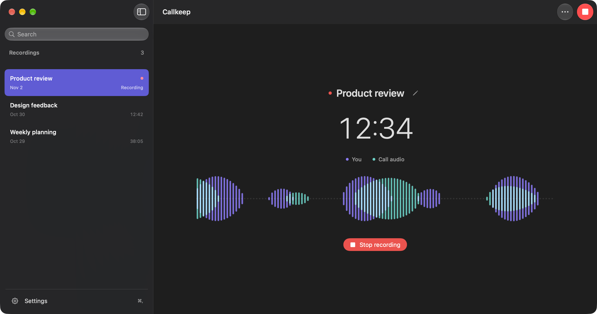
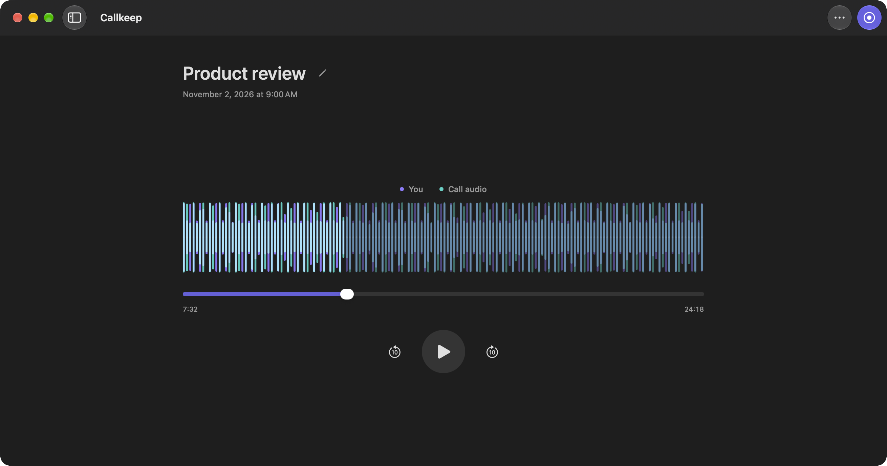
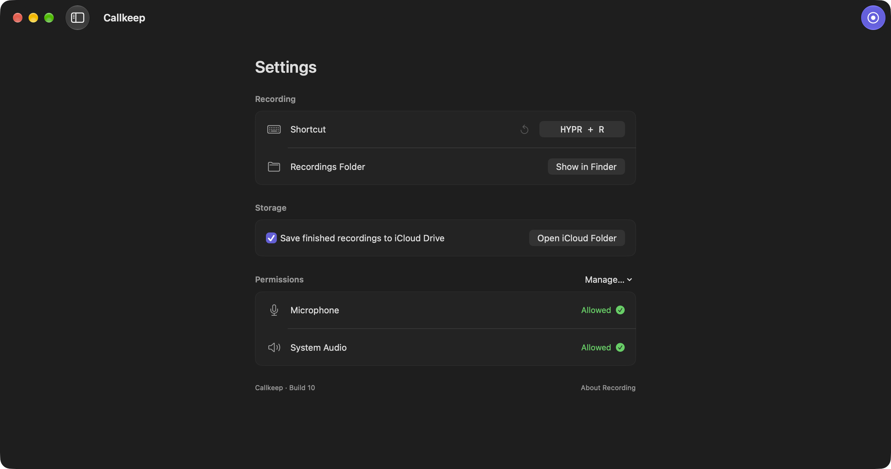

<p align="center">
  
</p>

<h1 align="center">Callkeep</h1>

<p align="center">A native macOS recorder for your microphone and computer audio, with local after-call transcription and optional iCloud Drive storage.</p>
<p align="center"><strong>macOS 15+</strong> · SwiftUI + AppKit · Apple silicon + Intel</p>



## Record both sides of a call

Callkeep captures your microphone and the audio playing on your Mac. It works alongside your calling app without joining the meeting or adding a bot.

- Start or stop from the menu bar, the app, or a keyboard shortcut.
- Browse and search your recordings, then replay them with a smooth, seekable timeline.
- Watch your voice and call audio together in a smooth, two-color waveform. Click either playback legend to hide and mute that track.
- Rename a call in place, including while recording. Select several with Shift-click or Command-click and move them to Trash together.
- Keep lossless audio and transcripts in Callkeep’s native iCloud Drive folder.
- Import existing Callkeep recording folders without changing the originals.
- Get a Record / Dismiss reminder when a supported calling app, including FaceTime, uses the microphone. [How reminders work](docs/CALL_REMINDERS.md).
- See permission status automatically, with guided setup when access is missing.

Choose and download **Parakeet Ultra** or **Whisper Turbo** in Settings to transcribe after each call locally on Apple silicon. The transcript below playback keeps timestamped **You** and **Call audio** text, follows the audio and lets you compare model runs. macOS can notify you when a transcript is ready. See [local transcription](docs/TRANSCRIPTION.md). Live captions are not included.



<table>
  <tr>
    <td width="50%"></td>
    <td width="50%"></td>
  </tr>
  <tr>
    <td align="center">Playback</td>
    <td align="center">Settings</td>
  </tr>
</table>

<sub>Screenshots show the app with generated sample recordings.</sub>

## Get started

1. Install and open Callkeep using the public Homebrew recipe described below.
2. Open **Settings → Permissions** and enable microphone and system audio access. The app guides you to the relevant macOS controls.
3. In **Settings → Transcription**, download a model for local after-call transcripts (Apple silicon).
4. Click **New recording**, then **Stop recording** when the call ends.

Get everyone’s agreement before recording. Callkeep captures audio from all apps, and muting your microphone in a calling app does not mute Callkeep. Headphones avoid recording speaker audio twice.

Closing the window keeps Callkeep running. Open it again from the Dock or menu bar.
Enable **Settings → General → Launch at login** to start quietly in the menu bar when you sign in to your Mac. Opening Callkeep yourself shows the library; **⌘Q** quits the app and stops call detection.

## Keyboard shortcuts

| Action | Shortcut |
| --- | --- |
| Start / stop recording | **HYPR + R** — ⌃⌥⇧⌘R, customizable in Settings |
| Show / hide sidebar | ⌘B |
| Open Settings | ⌘, |
| Import Callkeep recording folders | ⇧⌘I |
| Rename selected recording | Return |
| Save / cancel rename | Return / Escape |
| Move selected recordings to Trash | ⌘⌫ |

## Install

```sh
brew install --cask 0x63616c/tap/callkeep
```

Or tap once, then install by name:

```sh
brew tap 0x63616c/tap
brew install --cask callkeep
```

Updates use `brew upgrade --cask 0x63616c/tap/callkeep`. Downloads are public; no GitHub login is needed.
Requires macOS 15 or later on Apple silicon or Intel. New release builds are signed with Developer ID and notarized by Apple.
Versions through 0.1.3 were ad-hoc signed and may require approval in **System Settings → Privacy & Security**.

Finished recordings move to **iCloud Drive → Callkeep** by default when available.
Active recordings stay local. Change this in **Settings → Storage**.

## Build

Open `Callkeep.xcodeproj` in Xcode and run the **Callkeep** scheme, or use:

```sh
./Scripts/build.sh
open build/Build/Products/Release/Callkeep.app
```

Xcode resolves the pinned transcription packages through Swift Package Manager. Local builds use ad-hoc signing by default. Native iCloud storage requires the provisioned, Developer ID signed release; ad-hoc builds keep new recordings local. The optional system-audio permission query uses a private macOS API.

[Development and permissions](docs/DEVELOPMENT.md) · [Recording and storage](docs/RECORDING.md) · [Validation](docs/VALIDATION.md)

## Release automation

Homebrew owns updates. Sparkle, the old appcast and in-app update controls are removed;
existing bundle/signing and iCloud identities are preserved.

After relevant changes pass `callkeep-ci.yml` on main, `callkeep-release.yml` reserves
`callkeep/v1.0.N`, builds both Mac architectures, signs with Developer ID and notarizes.
Read-only Match installs the Developer ID identity and iCloud profile from the private
`certificates` repository’s `callkeep` branch. Running **Callkeep delivery** manually on
`main` builds, signs and notarizes a disposable copy without publishing a release.
For automatic releases, the workflow retains the ZIP, symbols and acceptance receipt in the
immutable public release. It downloads the ZIP again and checks its checksum, signature and
source identity before updating Callkeep's tap cask.
Operational receipts stay in a version-scoped draft ledger, so completion does not mutate a
published immutable release. Retries reuse sealed artifacts; interrupted unsealed builds receive a new counter.
The tap uses a standard ZIP URL and SHA-256, without custom Git download strategies or
migration enable switches. Intel slices are built and checked; this does not prove Intel runtime behavior.

Releases come from [WWW](https://github.com/0x63616c/world-wide-webb/releases). The old
`callkeep` source was snapshotted into private `github-archive` and its repository was deleted.
