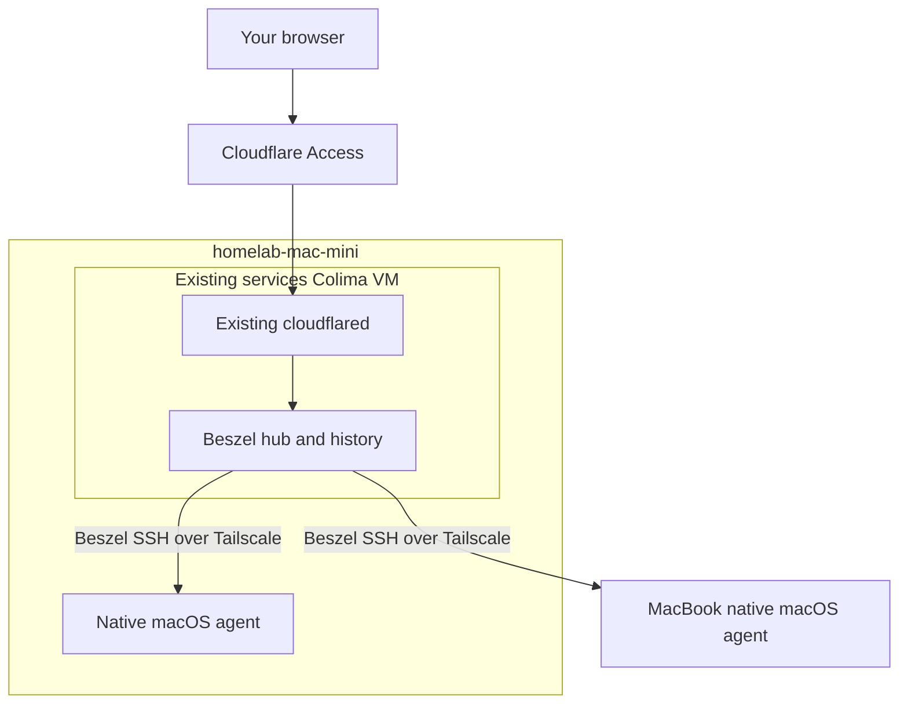

# Beszel monitoring plan

Reviewed design, inspected 2026-11-08. The hub and both agents are deployed;
public endpoint and restore validation are still in progress.

## Outcome

Open `https://beszel.worldwidewebb.co` to see both Macs: CPU, memory, disk,
network history and online/offline status. New nodes follow the same Git-defined pattern.

## Where it runs

- Hub: another pinned Compose service in the Mini's existing services VM.
  Persistent `/beszel_data` volume; loopback-only dashboard port for cloudflared;
  `APP_URL=https://beszel.worldwidewebb.co`.
- Agents: pinned native ARM64 binaries, system launchd daemons, dedicated non-admin
  service account with a verified unused fixed UID/GID and persistent private state
  on each Mac. No desktop login required. No Docker socket or administrator access.
- Connections: hub polls the agents on their Tailscale addresses using Beszel's
  embedded SSH protocol and its own key. This is separate from Remote Login.

This adds no VM. The earlier native-hub suggestion is technically possible, but
Compose reuses the rebuilt Mini's tunnel, service reconciliation and backup paths.

## Current evidence

- Mini is rebuilt: macOS 27.2, 8 GiB RAM, about 155 GiB available storage.
  Live Git revision: `676d6621bc1f3fa451595f87f1894be15b5b46fb`.
- It already has a 4 GiB services VM and separate 2 GiB HA VM. Container inventory
  showed the current application services running; Bambuddy, Hindsight, Penpot
  and HA responded to read-only HTTP probes.
- Native memory-pressure query reported 54% free and about 162 MiB swap used.
  This is one snapshot, not a capacity forecast or an Activity Monitor comparison.
- A read-only TCP probe from the existing Hindsight container reached port 22 on
  both Macs' Tailscale IPs. Beszel port 45876, key authentication and the exact
  hub container remain implementation tests.
- MacBook has 32 GiB RAM. Its live runner config permits two 4-vCPU/8-GiB jobs.
  Its revision file currently reports null; establish its exact applied source
  before deploying an agent there.
- Existing Cloudflare origins, Access applications and DNS records are managed
  together in `world-wide-webb/infra/cloudflare/main.tf`.

## Git ownership

**Private `homelab`:** hub Compose file, pinned packages, native agent module,
host assignments, declarative Beszel systems, resource limits, encrypted bootstrap
credentials, health checks and backup/restore integration. Extend existing service
contracts; do not introduce a second updater or backup scheduler.

**`world-wide-webb`:** add the `beszel` origin, DNS record and existing email Access
policy. Publish the hostname only after the hub is healthy and initialized.

The current public CLI schema already accepts service names as strings. Verify
the complete service contract, but do not add a CLI screen or require a CLI release
just to install monitoring.

## Setup and secrets

1. Generate a Beszel administrator password automatically on the operator's client;
   save it in the homelab 1Password vault and encrypt the runtime bootstrap value
   with the existing host/recovery age recipients. No manual copying.
2. Supply bootstrap credentials through a private, service-scoped runtime Compose
   env file. Upstream creates the application admin and PocketBase superuser
   before serving. No secrets in Nix derivations, Git plaintext, plists or argv.
3. The hub creates its own persistent SSH private key. Retrieve only its public
   key through the authenticated upstream API and commit that public value for
   both agents. Keep the private identity in the protected hub data/backup.
4. Generate token-free Beszel `config.yml` from the node inventory, including
   dashboard names, Tailscale endpoints and the owner email. Agents accept the
   hub key and listen only on the node's tailnet address, retrying at boot if needed.
5. Use the existing Cloudflare Access gate plus the normal Beszel login saved in
   1Password. Trusted-header SSO is deferred until its proxy trust boundary is proven.

Bootstrap environment values initialize a new database; changing them does not
rotate an existing password. Password rotation must update Beszel, 1Password and
the encrypted recovery value through the supported account interface.

Use the canonical Git hostnames and stable tailnet DNS endpoints from the start.
Beszel identifies a system by **name + address + port**. Changing any of these
replaces its record and deletes its historical statistics. A nonempty inventory
also deletes omitted systems and their history; an empty inventory skips sync.
Take a backup and plan an explicit migration before changing these identities.
Disabling only the agent retains the dashboard entry and history.

## Resources and recovery

- Keep the current services VM at 4 GiB. Start the hub with a provisional 128 MiB
  container memory cap and 0.5 CPU; accept those limits only after measuring startup,
  collection and backup. Do not increase VM reservations without evidence.
- Pin hub and agent versions together; use GitOps for updates. Start with standard
  host metrics, without privileged GPU collectors or root-running agents.
- Use Beszel's built-in tiered history, which retains increasingly coarse data out
  to 30 days in the researched version. Do not promise indefinite detailed history.
- Add hub data and its private key to the existing verified off-host backup flow.
  Stop the hub briefly for a consistent whole-directory snapshot and recover it
  through the existing operation lock. Prove restore into an isolated hub.
- Keep hub logs bounded. A hub cannot send an alert while it is down; independent
  hub-down alerting would require a separate observer and is outside this first cut.
- First cut shows offline status, including expected MacBook sleep. Notifications
  are a follow-up requiring a chosen destination, delay policy and delivery test;
  the bootstrap account email alone does not configure email delivery.

## Rollout and acceptance

1. Build and test the Compose, Nix, service-health and backup/restore contracts
   without enabling Beszel. Verify the locked Darwin package and image digest.
2. Enable the Mini hub privately; bootstrap it and capture its public key.
3. Enable both native agents and the declarative systems inventory. Verify real
   ingestion from both Macs, failed authentication with an unrelated key, and no
   LAN-facing listener. Inspect effective tailnet policy before claiming that
   network access is limited to the Mini; an additional narrow allow rule cannot
   override existing broad grants.
4. Check CPU/memory/disk values against native tools, including during a runner job.
   Validate APFS accounting and mark unsupported readings unavailable rather than zero.
   Measure hub/agent overhead and exercise offline/reconnect and pre-login startup.
   Schedule real Mac reboot tests separately; do not interrupt current workloads.
5. Prove backup restoration preserves users, history and the hub identity, then
   enables agents to reconnect. Database rollback needs the pre-upgrade backup,
   not just an older image.
6. Add the Cloudflare origin/DNS/Access entry. Test access denied without approval,
   authorized browser login and working charts. Agent traffic remains private.

Success: one browser dashboard with two live host entries, persistent history,
verified recovery and Git-managed installation on both nodes.

## Separate follow-up: per-run measurements

This first cut shows physical host totals. Docker container metrics would require
additional runtime access; do not grant the native agents the Docker socket merely
to add charts. Beszel does not attribute Tart VM usage to GitHub jobs.
Add a bounded per-run sampler/report to the existing runner flow
later, recording actual usage, host/VM identity and the assigned job link before
deletion. Save it as a GitHub job summary/artifact. Do not enroll every disposable
VM as a permanent Beszel system.

Primary sources and detailed findings: [Beszel research](research/beszel.md).
