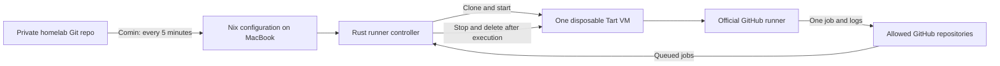

# Disposable macOS runners: implementation plan

Status: implementation reference, updated 8 November 2026. Configurable concurrency is implemented in source; deploying this change and proving two live jobs remain pending. The original research and rollout gates below are retained.

## What we are building

One small Rust service on `homelab-macbook`. It watches an explicit list of GitHub repositories, creates a fresh Tart macOS VM when work is waiting, runs one GitHub job, then deletes the VM. No waiting VMs. Capacity is configurable; the MacBook is configured for up to two owned attempts, subject to disk admission reserves. VM startup is serialized; prepared guests can run jobs concurrently.

The initial repository is `0x63616c/world-wide-webb`. The controller accepts a typed repository allowlist from private Git configuration; no project name or workflow is hardcoded into its scheduling or lifecycle. Adding another repository later requires granting the GitHub App access, adding it to that allowlist and updating its workflow routing, without controller code changes. Capacity is shared across the allowlist, with a new repository-scoped runner for each execution. Personal-account repositories cannot simply share one organization runner registration. GitHub still owns job assignment, execution status, cancellation and logs.

Your private `homelab` repository remains the source of truth. Its existing Comin service checks main every five minutes and applies Nix configuration. The runner controller never pulls Git or deploys itself. The setup CLI only enrolls a Mac; it does not become another runner management tool.

The Mac mini, production containers and Linux runners are outside this first implementation. There is no Temporal, Kubernetes, Orchard, webhook server or distributed scheduler.

### What can actually move first

Checked current GitHub main: `world-wide-webb` at `1528934`, `folding` at `6b402e6`.

- `world-wide-webb/.github/workflows/ci.yml` has an Apple job on `macos-26`, a 25-minute timeout, Xcode selection and `xcodegen`. Its toolchain selector requires Xcode 26.4 or newer. Choose and inspect an image that satisfies that requirement; the host's macOS version alone is irrelevant to the guest toolchain.
- The same repo's TestFlight job handles signing credentials and reaches the mini through Tailscale. Leave it on its current runner initially. Supporting that later requires an explicit credentials/network policy, not an unnoticed exception to isolation.
- `folding` currently has a manually dispatched Ubuntu contract-check job. It is outside the initial rollout; moving its actual checks later needs a Linux profile or an intentional, separately verified portability change.
- Linux CI, Docker builds, Cloudflare and mini deployment workflows keep their current routing. Adding the controller will not automatically move them.

The first useful migration is therefore the ordinary Apple CI job in `world-wide-webb`, after its trust gate passes. [Current workflow](https://github.com/0x63616c/world-wide-webb/blob/152893402893b78b1c8dbe8da23c5d2acd6bb950/.github/workflows/ci.yml), [toolchain selector](https://github.com/0x63616c/world-wide-webb/blob/152893402893b78b1c8dbe8da23c5d2acd6bb950/.github/scripts/apple-toolchain.py).

## How the pieces fit

There are three ownership boundaries:

- **Private `homelab`:** host declarations, repository allowlist, tool/image pins, resource limits and encrypted secrets.
- **Generic runner code:** a small Rust workspace with controller and guest-helper binaries, tests and an image recipe. Proposed public repository `homelab-runner`, so generic code can use public CI without exposing your configuration. Creating/publishing it is a later implementation step.
- **Application repositories:** workflows, build commands and job permissions. They select the `homelab-tart` runner label. Application code and deployment configuration stay in their current repositories.

## What changes on the MacBook

Reuse the existing non-admin `_runner` account, UID/GID 451, home `/var/lib/_runner`. Install one system LaunchDaemon under that identity, plus pinned Tart and Softnet. No host-side Actions runner, desktop login, 1Password installation or new admin account.

Nix owns the executable paths, permissions, service definition and runtime configuration. Sops-nix decrypts the GitHub App private key to a runtime file readable only by `_runner`. App identifiers are ordinary configuration; the PEM is not placed in the Nix store.

Tart already has packaging pins in this repo: 2.41.1, with Softnet 0.25.0. Reuse their signed bundles and verify the exact release licenses before adoption. Both selected releases use FSL-1.1-ALv2; they are not conventional permissive OSS releases. Existing packaging checks do not prove unattended VM operation. [Tart license](https://github.com/openai/tart/blob/2.41.1/LICENSE), [Softnet license](https://github.com/openai/softnet/blob/0.25.0/LICENSE).

Start with 4 vCPUs and 8 GiB RAM for the guest on the 32 GiB M2. Keep one digest-pinned, single-Xcode base image, and temporarily one candidate during upgrades. APFS clones share unchanged blocks, but guest writes consume real storage: a 140 GB virtual disk is neither a 140 GB download nor an enforced host write quota. Measure the chosen image before setting the admission reserve and emergency free-space floor. Do not reuse old provisional storage numbers as measured guarantees.

## What happens for each job

1. Every 30 seconds, inspect allowed repositories for active workflow runs and their queued jobs. Honor API backoff and rate limits. Check all pages and current run attempts, including old runs being rerun and downstream/matrix jobs appearing later.
2. Choose eligible demand fairly between repositories, oldest eligible job within each repository. Require the dedicated label and a supported macOS/ARM64 profile; do not invent VM properties from arbitrary labels.
3. Recheck demand and storage, then durably reserve the only slot. Record a unique attempt/VM/runner name before creating anything.
4. Clone the approved image, apply the resource/network policy, boot, install the pinned official runner archive and fixed public guest helper, then wait for readiness before issuing any job credential.
5. Mint a repository-scoped just-in-time runner configuration. Deliver it to the guest helper through `tart exec -i` stdin, then start the official runner as an independent guest service.
6. Observe the actual assigned job. The polled candidate is a demand hint: GitHub can assign a different matching job from that repository. A cancellation of the original candidate must not kill another job that actually started.
7. Let the official runner handle the job and GitHub cancellation. On exit or an explicit deadline, collect bounded diagnostics, stop/delete the exact owned VM, retire its registration, then release the slot.

The supported runner profile is `[self-hosted, macOS, ARM64, homelab-tart]`. Workflows can request that profile; existing workflows must be inspected before changing their routing. One VM processes one job, even when a workflow has many jobs. [GitHub runner matching](https://docs.github.com/en/actions/how-tos/manage-runners/self-hosted-runners/use-in-a-workflow), [JIT runner contract](https://docs.github.com/en/rest/actions/self-hosted-runners#create-configuration-for-a-just-in-time-runner-for-a-repository).

The stock Xcode image and official Actions runner are pinned separately. `packages/runner.nix` exposes the public ARM64 runner archive as `runnerArchive`, version `runnerVersion`; `modules/runners.nix` supplies required `tart.runner_archive` (absolute immutable host file) and `tart.runner_version` (numeric three-part version) runtime fields. The selected [official v2.338.2 release](https://github.com/actions/runner/releases/tag/v2.338.2) publishes SHA-256 `25a065af409ffa317ab4d5a3b614dd15fc9c40f2172bc1b35a1b1258e919a388` for `actions-runner-osx-arm64-2.338.2.tar.gz`. Preparation streams this cached public archive into the disposable guest when its listener version differs, refuses existing credential files, and verifies the exact version before readiness. It does not download an SDK during each boot. The public guest helper is separately checked for Nix store load commands because stock macOS guests have no Nix installation.

Initial explicit defaults: queue polling 30 seconds, boot readiness deadline 10 minutes, unassigned runner deadline 5 minutes, and running-job deadline 2 hours. These are proposed policy values, not vendor guarantees or startup benchmarks. Persist absolute deadlines so restarting the controller cannot reset them. Workflow timeouts may be shorter.

The host retains protected typed summaries in `state_directory/attempt-<nonce>.json`, plus a `last-attempt.json` compatibility snapshot (0600 inside the service's 0700 state directory, maximum 4 KiB each). Every owned attempt and the latest 32 completed summaries are retained. It records the attempt nonce, timestamps, operation/outcome, first and latest safe error categories, and validated guest status including the official wrapper process's exit code. The controller attempts to persist this snapshot before stopping or deleting the VM; it survives slot release within that retention window. Diagnostic write failure warns and does not independently block safe emergency-space cleanup. This is a typed summary, not raw diagnostics: job stdout/stderr, runner `_diag`, credentials and environment values are never copied into it. The helper invokes pinned official `run.sh` with the SDK root as working directory and a fixed image tool PATH, including `/Users/admin/.cargo/bin`. The official wrapper retains its retry/update lifecycle for listener codes 2/3/4; supported `ACTIONS_RUNNER_RETURN_VERSION_DEPRECATED_EXIT_CODE=1` propagates deprecated-version exit 7. Wrapper exit zero can mask listener failures (including 1/5) and does not prove job success. Actual job outcome requires GitHub observations; this helper adds no custom runner retry loop or raw output parser.

Running-job cancellation remains the official listener's responsibility. Missing runner registration or unavailable API state does not itself prove cancellation; absent guest termination, VM interruption or a disk emergency, the persisted running deadline bounds recovery. Cleanup stops/deletes the owned VM before deleting its registration. A busy-registration HTTP rejection retains the slot and retries reconciliation; only observed absence of both owned resources releases it.

## Activation acknowledgement race

Drain reads the service's atomically replaced acknowledgement file. A reader
can open the old inode immediately before replacement unlinks it; the open
snapshot then has a link count of zero. Treat that already-open regular file
as valid after checking its mode and bounded contents, while still rejecting
extra hard links, symlinks and stale hold tokens. Requiring exactly one link
caused spurious permission failures and left an activation hold and an
interrupted update transaction. Deterministic replacement and concurrent-reader
regressions cover this case. Recovery must preserve the transaction, verify the
held runner is idle, and align the live and boot generations under the operation
lock before allowing another update.

## Concurrent capacity

`homelab.runners.maxConcurrentJobs` is emitted as `policy.max_concurrent_jobs`.
It defaults to one for older policy files. Both Nix options accept only 1 or 2,
and the controller rejects runtime policies outside that range before accessing
state or credentials. macOS limits each physical Mac to two concurrent macOS
guests; raising capacity beyond two requires another host. The Nix configuration
also requires the job limit to fit `tart.maxMacOSGuests`. The MacBook sets both
to two; disk admission reserves still apply. `nix flake check` verifies both
option types reject three, and runtime regression tests verify early rejection.

Starting, listening, running and cleaning attempts all occupy capacity. The slot
is released only after the exact VM, operation lease and runner registration are
confirmed absent. Lowering capacity leaves existing attempts intact and prevents
new admissions until ownership falls below the new limit. Holds suppress all
new work; drain acknowledges idle only when every attempt and owned resource is
absent. A v2 journal requires the new binary; drain and preserve a copy before
rolling back to a binary that only understands v1.

One durable writer allocates globally unique intent tickets and rotates fairly
across attempts. Temporary JIT inputs, VM process handles, operation tasks,
backoff and diagnostic summaries are isolated by attempt nonce. GitHub discovery,
installation token caching and API backoff remain shared. A queued job already
covered by an attempt is excluded from admission; the observed actual assignment
supersedes that attempt's provisional demand hint.

Clone, prepare, runner delivery, stop and delete execute as background tasks after
intent has been persisted. Completion is retained until journal reconciliation
commits it. After restart, missing process-local results are reconciled through
the existing leases and authoritative observations, never blindly replayed.
Startup and unproven startup cleanup suppress global Tart inventory across all
attempts, including stop/delete and lease retirement. Other prepared guests are
observed through positive guest-agent RPCs during that interval. One global VM
inventory snapshot is shared across an observation pass once startup is safe.

Admission reserves future disk growth for each owned guest. With admission
threshold A, emergency floor E, and K already owned attempts, a new guest needs
at least `A + K × (A − E)` free bytes. The MacBook's unchanged 140/80 GiB
thresholds therefore require 200 GiB free to admit the second guest. The observed
145 GiB on November 8 does not meet that gate. Disk emergencies apply the existing
cleanup policy to each attempt; uncertain cleanup retains capacity.

Implementation validation covers the two-job limit, early rejection of three, independent pending intents,
peer progress during a stalled operation, storage reservations, migration,
restart ownership, and all-attempt draining. Actual concurrent build capacity
requires a live two-job trial after deployment and sufficient disk space.

## Trust and secrets

Use a dedicated GitHub App installed only on the selected repositories. The REST design requires repository **Actions: read** and **Administration: write**, with implicit Metadata read. Administration write is broader than runner-only access; acknowledge that cost rather than describe it as a narrowly permissioned runner credential. No Contents or Workflows write permission is required. Installation tokens are short-lived and further restricted to the selected repository when minted. [GitHub installation authentication](https://docs.github.com/en/apps/creating-github-apps/authenticating-with-a-github-app/authenticating-as-a-github-app-installation), [runner API permissions](https://docs.github.com/en/rest/actions/self-hosted-runners).

The App PEM and installation token remain on the controller. The guest receives only its JIT runner credential and the job credentials GitHub normally supplies. Never mount the host filesystem, forward its SSH agent or copy its age key into a guest.

**Keep runner startup supported.** The inspected official runner accepts JIT via argv or `ACTIONS_RUNNER_INPUT_JITCONFIG`, not a documented stdin/file flag. The Rust guest helper will read the blob from stdin and set that input only in the child runner's short-lived environment, which the runner consumes. Do not put it in host environment/plists, command arguments or logs. This credential is intentionally available to its disposable guest; the VM is the isolation boundary. Avoid maintaining a custom decoder for GitHub's internal credential-file format. Confirm the exact pinned runner behavior with a real JIT smoke test. [Runner input source, v2.338.2](https://github.com/actions/runner/blob/v2.338.2/src/Runner.Listener/CommandSettings.cs).

The existing research note describes an internal-file decoding alternative. This plan deliberately chooses the supported environment input instead: less custom security-sensitive code, with the guest environment exposure stated explicitly.

`world-wide-webb` is public. You chose **collaborators-only pull requests**. Before registering runners there, apply that setting and audit existing queued/rerunnable untrusted runs, collaborators, and trigger paths such as `pull_request_target`, `workflow_run` and dispatch. Filtering the queue or using a special label alone is not an authorization boundary. Apply the same trust review before admitting any future repository. No repository settings were changed during this research. [GitHub PR restrictions](https://docs.github.com/en/repositories/managing-your-repositorys-settings-and-features/enabling-features-for-your-repository/disabling-pull-requests), [self-hosted security guidance](https://docs.github.com/en/actions/reference/security/secure-use).

Softnet must block access to the host, other guests, private LAN, tailnet, link-local and unintended IPv6 paths while allowing required public build endpoints. Test actual reachability, including public-address routes back into the LAN and DNS behavior. NAT alone is insufficient. Keep clipboard, audio, USB, shared folders and bridged networking off. Provision Softnet's privileged startup through one reviewed root-owned helper arrangement; never give `_runner` general passwordless sudo. [Softnet behavior](https://github.com/openai/softnet/blob/0.25.0/README.md).

## Small implementation and recovery contract

Use a Rust workspace, `just` recipes, pinned dependencies, and standard libraries: Tokio for asynchronous I/O/processes, reqwest for GitHub, serde for typed configuration/state, tracing for structured events, and a maintained JWT/RSA implementation for App authentication. Do not implement cryptography or a generic plugin framework.

The scheduler is a pure decision module: typed configuration + observations + durable state + time produce explicit actions. GitHub and Tart/guest adapters execute those actions. Tests replace adapters and the clock; the production code uses the same decision logic.

A versioned atomic state file records every owned attempt. Version 2 retains the first attempt in `active` and the rest in `additional`; version 1 journals are migrated on load without dropping ownership. Use private permissions, write/fsync/rename/directory-fsync, and an exclusive controller lock. Lifecycle:

`Idle → Starting → Listening → Running → Cleaning → Idle`

Any uncertain operation retains ownership and enters reconciliation. Persist intent before external effects, then reconcile unique names/returned IDs after ambiguous responses. Never blindly create another runner after a timed-out JIT request. Never delete an unrelated VM or registration. A corrupt journal, unknown inventory or failed cleanup blocks admission with an actionable reason.

A known failed clone or rejected JIT request is recoverable: prove the attempted resources are absent or finish their cleanup, then release the slot and retry with backoff. Uncertainty blocks admission; a conclusively failed operation must not leave the service permanently stuck.

Controller restart must reconcile existing VM state and actual runner/job identity. Test whether Tart survives its launchd parent's restart; if it does not, treat that attempt as interrupted, clean it up, and let GitHub/workflow policy determine retry. Never claim that a restarted controller or host can resume an interrupted build. A missing runner or stopped VM is not proof of job success.

A config change stops new admission while it is validated. Removed repositories receive no new capacity; an already running job may finish. Image changes affect future guests. A binary/service replacement must preserve a running guest or defer restart until idle; choose and prove that mechanism before enabling automatic upgrades. Do not assume a plist change is harmless. Retain the active tool/image generation until its attempt is cleaned up.

Guest startup is an independent service, not a long-lived attached exec connection. The helper exposes bounded status with no secret payloads. Image promotion verifies tool versions, guest identity, auto-login/agent behavior and absence of retained credentials. GitHub's runner may update inside the disposable clone; monitor image/runner freshness rather than disabling updates without implementing GitHub's update deadlines.

Diagnostics must show the exact failed operation, safe error category, repo/run/attempt/job/VM/runner identifiers, timestamps and next action. Keep structured rotated host logs, bounded guest lifecycle events and protected runner diagnostics. Do not automatically publish raw `_diag` logs: they can contain sensitive job output. Never log PEMs, tokens, JIT input, arbitrary response bodies or process environments. Idle with no VM is healthy; stale GitHub connectivity and blocked admission are distinct degraded states.

## Prove the difficult parts first

Before implementing the full controller, run two short, separately reviewable feasibility tests after authorization:

1. **GitHub:** create/delete a JIT runner for a personal private repository with the proposed App permissions. Resolve the required runner-group ID from actual behavior; the documentation's example `1` is not a universal guarantee. Prove the pinned official runner starts from the guest-helper input path and exits after one harmless job.
2. **Mac service:** as the actual non-admin system LaunchDaemon, prove Tart clone/run/exec/stop/delete before GUI login, with the intended keychain and Softnet setup. Tart's macOS15+ headless keychain requirement is an open dependency. Use a dedicated service keychain, not the human's keychain; keep any unlock secret in sops and out of argv/logs. Prove the precise supported unlock mechanism before committing to it. [Tart headless FAQ](https://github.com/openai/tart/blob/2.41.1/docs/faq.md).

If either fails, stop and report that precise blocker. Do not build another orchestration layer to work around an unproven foundation. These tests have **not** run as part of this research.

## Tests and rollout

**Local and public CI:** exercise the state machine using deterministic fake adapters. Cover simultaneous demand, fairness, matrices/dependencies, old-run reruns, unsupported labels, cancellation, candidate/actual-job mismatch, API outages/rate limits/pagination saturation, and runner updates. Inject crashes before and after every side effect and failed atomic write; verify the configured capacity, no replayed job, owned-resource-only cleanup and no secrets in captured logs. Test recorded Tart JSON fixtures and argv, with no shell interpolation.

Explicit recovery fixtures include partial clone, rejected JIT creation, a lost successful JIT response and failed deletion. Assert eventual return to Idle after confirmed cleanup, with no premature slot release. Test admission disabled in Starting, Listening, Running and Cleaning; stopping new work must not skip cleanup.

**Disposable integration:** prove real App/JIT and official runner compatibility; actual image manifest and guest service; controller/transport crashes; cleanup failures; guest disk full and host free-space floor; measured cold/cached startup and Xcode resource use; Softnet reachability; idle base-image updates and updates during an active job. Reboot tests must include the real service context and distinguish interrupted-job cleanup from successful-job completion.

**GitOps rollout:** first merge code/package/config with runners disabled. Complete the feasibility, security and recovery evidence against pinned versions, including `world-wide-webb`'s collaborator-only setting and existing-run audit. Only then change private `homelab` main to enable one slot for a harmless manually dispatched smoke workflow in `world-wide-webb`. Comin applies it within roughly five minutes. Prove cleanup, then route its ordinary Apple CI job to the runner. No second repository is needed for initial acceptance; fake-adapter tests still cover multiple repositories, fairness and isolation between registrations.

Expose an explicit admission setting in the private Nix configuration. Setting admission off keeps the daemon installed so it can finish and clean the current attempt. Removing/disabling the LaunchDaemon is a later step after it reports idle. Emergency service stop may interrupt a job and requires reconciliation; it is not called graceful draining.

Replace the dormant Python runner policy and its synthetic tests with the validated Rust implementation; retain useful signed tool packaging. Replace the old runner implementation document with a short pointer to the final design. Do not modify unrelated container, Home Assistant or enrollment flows.

## Daily use and later growth

You push to an allowed repo and watch normal GitHub Actions. When idle, the host keeps only the service and base image. Config changes are PRs in private `homelab`; merging main updates the Mac. A runner problem is visible in structured host diagnostics and the GitHub job, with enough correlation to investigate without screenshots.

There is no new per-job billable hosted-Mac service in this design. Storage, electricity and maintenance remain yours; verify current GitHub account terms and selected tool licenses before rollout. Startup latency is unmeasured until the selected image is tested: queued work adds up to one polling interval plus clone/boot/runner startup, and initial image download is separate.

Later, Linux means another approved image/profile and tests. Multiple Macs require an explicit capacity model: independent one-slot hosts allow one job **per host**, not a fleet-wide limit. Revisit a shared scheduler or the official scale-set protocol only when that is needed. GitHub's standalone `actions/scaleset` Go client is currently public preview; adopting it now would add a second language/helper or a protocol port. REST polling is a deliberate small-scale choice, not GitHub's preferred autoscaling mechanism. [Official scale-set client](https://github.com/actions/scaleset), [REST best practices](https://docs.github.com/en/rest/using-the-rest-api/best-practices-for-using-the-rest-api).

Detailed evidence: [GitHub research](research/runner-controller-github.md) and [Tart research](research/runner-controller-tart.md).

## Independent review

An independent agent reviewed the proposal for simplicity, secrets, trust, recovery and tests. Its three actionable findings were addressed: distinguish admission draining from daemon removal, specify slot release after proven failed creation, and mark the internal JIT decoder as superseded. The review supported the small REST/JIT/Tart approach conditional on the stated feasibility gates. It did not certify runtime behavior.

No implementation, account setting changes or deployment were performed for this plan.
