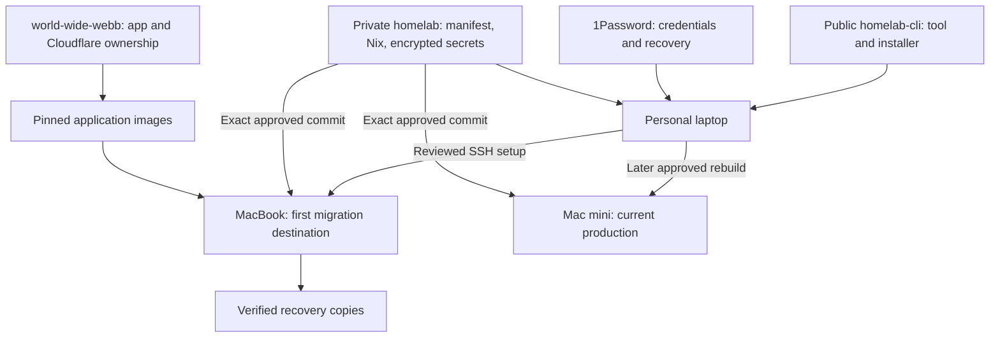
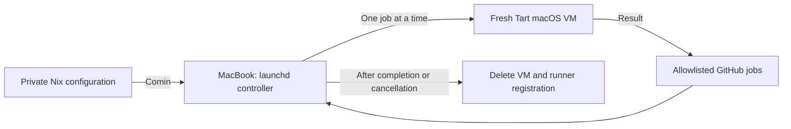

# Homelab

Desired configuration for the MacBook and Mac mini, colocated with the setup CLI in
[`cli`](cli/README.md). This is the imported monorepo candidate. Live hosts still follow their
existing repository until the [migration handover](../docs/plans/monorepo-migration-progress.md)
is verified; the historical instructions below describe that existing authority.

Use repository-root `flake.nix`, `flake.lock`, `homelab.json`, `bootstrap/installer.json`
and host ciphertext in `secrets/` for enrollment. These are regular compatibility files.
`flake-outputs.nix` owns the implementation. The CLI and private host tools build from
filtered local sources; unrelated app files are excluded from those package inputs.

From the monorepo root:

```sh
nix flake check --no-update-lock-file --print-build-logs
nix develop --command python3 -m unittest discover -s homelab/tests
cargo test --locked --manifest-path homelab/cli/Cargo.toml
cargo test --locked --manifest-path homelab/host/Cargo.toml
cargo test --locked --manifest-path homelab/runner/Cargo.toml
```

These checks do not activate a host. `Homelab CI` selects configuration/controller/operations
checks for host changes and CLI checks for CLI changes. CLI changes also verify host compatibility.
Promotion, private CLI distribution and preserve-state repository rebind are pending; source imports
alone do not transfer deployment ownership. Existing dirty source work remains in its original checkout.

## Historical deployment documentation

Private configuration for the macOS homelab. The MacBook is enrolled and configured
for disposable CI runners. Application migration remains disabled; the Mac mini
continues running its existing services.

## Start here

Install the public [homelab CLI](https://github.com/0x63616c/homelab-cli), open
`homelab`, and attach **`0x63616c/homelab`** when asked.

1. On the target Mac, create its administrator and enable Remote Login.
2. Attach this repository in the CLI, select its Git-defined Mac and confirm the address.
3. Review **Begin setup**; follow the live checklist as the wizard prepares enrollment.
4. It publishes encrypted configuration to `main`, installs that exact commit,
   reboots and verifies the Mac. Required or existing PRs still wait for review.

Use [CLI 0.4.0](https://github.com/0x63616c/homelab-cli/releases/tag/v0.4.0)
for the live checklist and direct-publication flow. Begin setup authorizes direct
publication when GitHub rules permit it; the CLI never force-pushes or bypasses
required PR review. Version 0.3.2 uses PR-based enrollment.

`homelab.json` supplies the host list and administrator accounts. The CLI asks only
for a new host’s connection address, defaulting to `<host>.local`. Saved aliases,
SSH identities and setup state are reused; local connection settings are not a
second desired-host inventory. Resuming approved setup uses its saved exact Git
revision even if `main` changes or removes the host. Use **Edit address** to correct
a saved connection without recreating its setup.

The CLI ships its bootstrap helper. Your personal laptop needs neither Nix nor a local
bootstrap build. Nix is installed and runs on the target only after approval.
See the short [setup guide](docs/setup.md).

## Architecture



| Component | Responsibility |
| --- | --- |
| Public CLI | Guided setup, SSH, credential adapters, portable bootstrap |
| This repository | Desired host state, services, encrypted secrets, private health/restore checks |
| `homelab.json` | Host facts shared by the CLI and Nix; no duplicate host lists |
| 1Password | Operator credentials and recovery keys; never installed on nodes |
| SOPS + age | Encrypted Git secrets; each node gets only its own key |
| Comin | Pull and apply reviewed changes from `main` after enrollment |
| launchd | Start services at boot, including Comin |

## Hosts

| Host | Hardware | Administrator | Intended first role |
| --- | --- | --- | --- |
| `homelab-macbook` | M2 Pro, 12 cores, 32 GB, about 500 GB | `admin` | Disposable CI guests; application migration later |
| `homelab-mac-mini` | M2, 8 GB | `calum` | Keep production running until verified cutover |

## What a merge does

After a Mac completes enrollment, Comin checks `main` every 30 seconds and applies
changes automatically. The interval is declared as `poller.period = 30` in
[`modules/updates.nix`](modules/updates.nix). Review and
test before merging; the node uses a read-only deploy key and needs no Actions token.
The wizard holds its approved commit through setup and reboot, then verifies the
handover to Comin. See [how updates work](docs/updates.md).

The MacBook has completed enrollment. Application services remain disabled;
the [runner validation record](docs/research/runner-validation.md) covers execution,
recovery, isolation and unattended startup proofs and their limits.
See [VM evidence](docs/vm-validation.md) for the separate setup, reboot and Comin
tests and their limits.
Private Actions workflows are manual-only until self-hosted runners are ready;
routine validation runs in the disposable Mac VM without paid private CI minutes.

## GitHub runners



The controller runs as `_runner`. It supports four shared job slots with at most
two macOS guests; Linux ARM64 can use all four when macOS work is not waiting.
Linux image promotion and rollout are described in [Linux runners](docs/linux-runners.md).
Jobs run inside fresh VMs with a pinned GitHub runner SDK. Softnet blocks access
to the host, LAN and tailnet. No idle VM is kept running. The GitHub App key stays on the host; only a short-lived JIT
registration is passed into each guest.

Repository access, image digest, resources and storage floors live in
[`hosts/homelab-macbook.nix`](hosts/homelab-macbook.nix). Start with
`world-wide-webb`; add further installed repositories to the same allowlist.
Updates hold new admission and wait for cleanup before replacing the service.
Runner and VM names include the physical host and a unique attempt ID, for example
`homelab-macbook-job-43dba142054549308342c9486695204d`. The guest hostname matches.
Controller logs record that name and the actual assigned GitHub job URL; the
private `last-attempt.json` retains both resource names and job IDs after cleanup.
See the [controller plan](docs/runner-controller-plan.md) and
[validation evidence](docs/research/runner-validation.md).

## Monitoring

Beszel runs in the Mini's existing services VM; native non-admin agents report
physical Mac metrics over Tailscale. Open `https://beszel.worldwidewebb.co` through
Cloudflare Access and use the **Homelab Beszel** login in the homelab 1Password vault.
Accounts and both system entries are provisioned automatically.

The hub's public key lives in `lib/beszel-hub.pub`; its private identity and history
stay in the backed-up data volume. System names, addresses and ports are stable
identities: changing them in Beszel's inventory can delete the old history.
See [the setup and recovery plan](docs/beszel-plan.md).

## Find the details

- [Setup and adding a host](docs/setup.md)
- [CLI separation plan](docs/cli-extraction-plan.md)
- [Disposable VM validation](docs/vm-validation.md)
- [Current-state research](docs/current-state.md)
- [Migration plan](docs/plan.md) · [Implementation status](docs/implementation-status.md)
- [Secrets](docs/secrets.md) · [Updates](docs/updates.md) · [Operations](docs/operations.md)
- [Application ownership](docs/releases.md) · [Recovery rehearsal](docs/restore-rehearsal.md)

`world-wide-webb` keeps application source and current Cloudflare management.
Only the tunnel process transfers at an explicitly reviewed service cutover.
