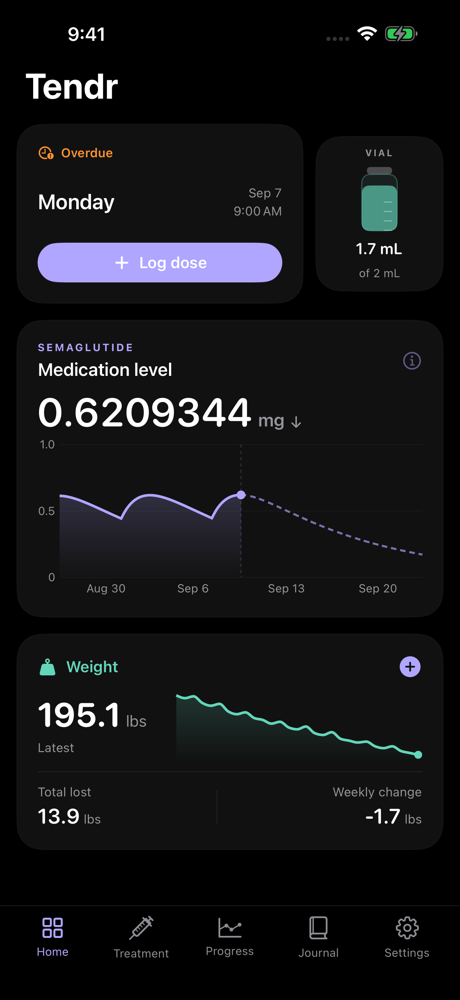

# Tendr

A native, local-first iPhone journal for GLP-1 treatment. Built with SwiftUI and Swift Charts, with no sign-in, tracking SDKs or runtime dependencies.

Available as a private TestFlight beta.

Track doses in mg; keep vial records; log weight and notes; import body weight read-only from Apple Health; review progress and estimated medication decay, including what your schedule implies; and schedule weekly, every-few-days or hand-picked dose dates, with reminders. A schedule can be cleared at any time. You can edit past records and optionally keep Tendr's weight history anchored to your first dose.

Medication curves are simplified half-life estimates, not measured body or blood levels or dosing advice. Historical records retain their medication and concentration. Follow the instructions from your prescriber.

## Screenshots

Actual iPhone 17 Pro Max simulator captures using synthetic data.



## Run

Requires macOS, Xcode 26.2 or later and [XcodeGen](https://github.com/yonaskolb/XcodeGen).

```sh
xcodegen generate
open Still.xcodeproj
```

Choose the Still scheme and an iPhone simulator. The internal target and bundle identifier still use the earlier project name. For a device build, select your own development team.

Launch with `--demo` for synthetic, in-memory sample data. Demo mode never writes to your health journal or schedules reminders. `--uitest` selects a separate test journal when used without demo mode.

## Tests

```sh
swift test
xcodebuild -project Still.xcodeproj -scheme Still \
  -destination 'platform=iOS Simulator,name=Tend QA Pro Max' test \
  CODE_SIGNING_ALLOWED=NO
```

The Swift package tests cover calculations, validation, local calendar scheduling and file compatibility. UI tests exercise real simulator screens. See [architecture](docs/ARCHITECTURE.md), [user journeys](docs/USER-JOURNEYS.md) and [verification notes](docs/TESTING.md). Passing tests do not imply clinical validation or TestFlight publication.

## Adaptive windows and Duo captures

Compact windows retain the five tabs. On supported systems, adaptive system navigation presents those same sections in a sidebar when space permits; navigation, filters and editor drafts stay in the same view hierarchy during resize. Portrait and landscape are enabled.

From the repository root on macOS with the Duo simulator installed:

```sh
DEVELOPER_DIR=/Applications/Xcode_27.2.app/Contents/Developer scripts/capture-duo-screenshots.sh tendr
```

Release capture uses one app session for the five configured shots on each Duo display, switching appearance in place. Interaction and rotation tests run separately. Device Hub operates on the hosted runner so capture does not take over a developer’s desktop. See [Duo validation](docs/DUO.md) for display detection, raw captures and the native resize checklist.

## Monorepo

Run app-local build/test commands above from `projects/tendr`. Shared release, CI and
Pages commands run from the repository root; see [root README](../../README.md).
See [How App Store releases work](../../docs/RELEASE.md#how-app-store-releases-work)
for the shared merge, TestFlight, tag and review process. Tendr owns its UI package
in `Packages/RDesign`; other apps keep their own design systems.

## Privacy and storage

The health journal is stored in the app's Application Support directory using atomic file writes. Apple Health access is read-only. No backend or telemetry is included. Device backups follow iOS settings.

## Contributing

Keep changes focused on a user journey. Add a failing regression test before changing calculation or persistence behaviour, and include actual simulator screenshots for UI changes. Never commit personal health data, signing credentials or provisioning profiles. Use synthetic fixtures in screenshots.
